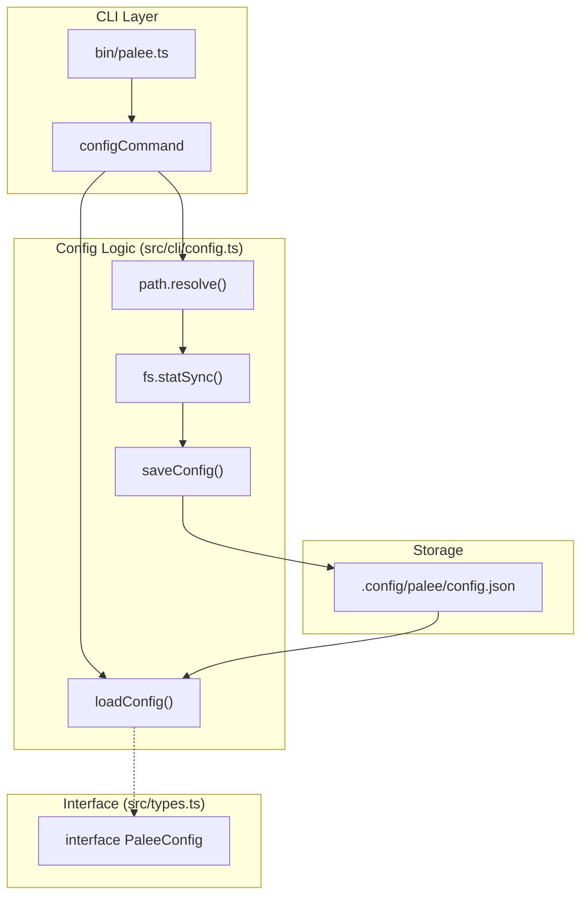
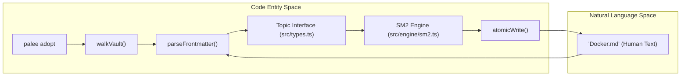

# Getting Started
::: details Relevant Source Files

- [README.md](https://github.com/Kuldeep2822k/cli/blob/main/README.md?plain=1)
- [planning/example_workflows.md](https://github.com/Kuldeep2822k/cli/blob/main/planning/example_workflows.md?plain=1)
- [planning/palee_cli_spec.md](https://github.com/Kuldeep2822k/cli/blob/main/planning/palee_cli_spec.md?plain=1)
- [src/cli/config.ts](https://github.com/Kuldeep2822k/cli/blob/main/src/cli/config.ts)
- [src/cli/review.ts](https://github.com/Kuldeep2822k/cli/blob/main/src/cli/review.ts)
- [test/cli-commands.test.ts](https://github.com/Kuldeep2822k/cli/blob/main/test/cli-commands.test.ts)

:::

This page provides a technical guide for installing and configuring PALEE (Personal Active Learning & Evaluation Engine). It covers the global installation process, vault connection, and the configuration of AI providers.

## Installation

PALEE is distributed as a global npm package. It requires Node.js ≥ 22[planning/palee_cli_spec.md](https://github.com/Kuldeep2822k/cli/blob/main/planning/palee_cli_spec.md?plain=1)

```
npm install -g @kuldeep2822k/palee
```

Upgrade that global install later with `palee update` (`--dry-run` reports without installing).
Upon installation, the `palee` binary becomes available. The CLI uses standard exit codes for scripting: `0` for success, `2` for usage errors and confirmation-time configuration races, and `4` for optimistic concurrency conflicts during file writes [README.md#exit-codes](https://github.com/Kuldeep2822k/cli/blob/main/README.md#exit-codes)

Sources:[README.md](https://github.com/Kuldeep2822k/cli/blob/main/README.md?plain=1)[planning/palee_cli_spec.md](https://github.com/Kuldeep2822k/cli/blob/main/planning/palee_cli_spec.md?plain=1)[planning/palee_cli_spec.md](https://github.com/Kuldeep2822k/cli/blob/main/planning/palee_cli_spec.md?plain=1)

---

## Initial Configuration

PALEE requires a connection to an Obsidian vault to function, as the vault serves as the canonical source of truth [planning/palee_cli_spec.md](https://github.com/Kuldeep2822k/cli/blob/main/planning/palee_cli_spec.md?plain=1)

### 1. Connecting a Vault

The `palee config set-vault <path>` command validates that the provided path exists and is a directory before saving it to the global configuration [src/cli/config.ts](https://github.com/Kuldeep2822k/cli/blob/main/src/cli/config.ts)

```
palee config set-vault ~/Documents/Obsidian/Learning
```

### 2. AI Provider Setup (Optional)

While PALEE's core engine is deterministic, advanced features like Feynman testing require an OpenAI-compatible API endpoint [README.md](https://github.com/Kuldeep2822k/cli/blob/main/README.md?plain=1)

```
palee config set-provider opencode
palee config set-base-url "https://opencode.ai/zen/v1"
palee config set-api-key --from-env OPENCODE_API_KEY
palee config set-model "nemotron-3-ultra-free"
```

`set-api-key` reads the key from `--from-env`, from a pipe, or from an interactive prompt; passing it as an
argument is refused so the secret never enters `argv`. `palee config unset-api-key` removes it again. A
`PALEE_API_KEY` in the environment outranks the stored key, for anyone who would rather never write it to
disk. If you change `set-base-url` to a different origin while a key is stored, PALEE asks for confirmation on a
terminal; pass `--keep-key` to skip the prompt. A non-interactive or `--json` run refuses without that flag, so
run `palee config unset-api-key` first if the stored key should not follow the new endpoint.

Confirm the whole path with `palee config test-connection`, which sends one short prompt and prints the URL
it called, which key source was used, the latency and the token counts. It is the only command that reaches
the network: `next`, `plan`, `review`, `validate`, `adopt` and `roadmap --from` remain offline by
construction, and a test over `src/` fails if a second socket site is ever added.

### 3. Verifying Configuration

Use `palee config show` to view the active configuration. For security, the `api_key` is never printed to the console — it shows as `••••••••` [src/cli/config.ts](https://github.com/Kuldeep2822k/cli/blob/main/src/cli/config.ts)

Sources:[src/cli/config.ts](https://github.com/Kuldeep2822k/cli/blob/main/src/cli/config.ts)[README.md](https://github.com/Kuldeep2822k/cli/blob/main/README.md?plain=1)[planning/palee_cli_spec.md](https://github.com/Kuldeep2822k/cli/blob/main/planning/palee_cli_spec.md?plain=1)

---

## Configuration Data Flow

The configuration is managed by the `configCommand` handler and persisted in a platform-specific `config.json` file.

### Configuration Persistence Mapping

| Platform | Path |
| --- | --- |
| Windows | `%LOCALAPPDATA%\palee\config.json` |
| Unix/macOS | `~/.config/palee/config.json` |
| Override | `process.env.PALEE_CONFIG_DIR` |

Sources:[src/cli/config.ts](https://github.com/Kuldeep2822k/cli/blob/main/src/cli/config.ts)[README.md](https://github.com/Kuldeep2822k/cli/blob/main/README.md?plain=1)

### Implementation Diagram: Configuration Logic

This diagram traces how `configCommand` interacts with the `PaleeConfig` interface and the file system.



Sources:[src/cli/config.ts](https://github.com/Kuldeep2822k/cli/blob/main/src/cli/config.ts)[src/cli/config.ts](https://github.com/Kuldeep2822k/cli/blob/main/src/cli/config.ts)[src/types.ts](https://github.com/Kuldeep2822k/cli/blob/main/src/types.ts)

---

## Adopting Your First Topic

Once configured, you must "adopt" existing Markdown files into the PALEE system. This process injects the necessary YAML frontmatter without destroying existing note content [planning/palee_cli_spec.md](https://github.com/Kuldeep2822k/cli/blob/main/planning/palee_cli_spec.md?plain=1)

```
palee adopt "Docker Fundamentals.md" --difficulty beginner
```

### The Adoption Process

1. Path Validation: The CLI ensures the file is within the configured vault and prevents path traversal [test/cli-commands.test.ts](https://github.com/Kuldeep2822k/cli/blob/main/test/cli-commands.test.ts)
2. Frontmatter Injection: The `updateFrontmatter` utility adds `palee_id`, `palee_schema`, and initial SM-2 metrics (e.g., `ease_factor: 2.5`) [src/cli/review.ts](https://github.com/Kuldeep2822k/cli/blob/main/src/cli/review.ts)[planning/example_workflows.md](https://github.com/Kuldeep2822k/cli/blob/main/planning/example_workflows.md?plain=1)
3. Atomic Write: The system uses `atomicWrite` with a SHA-256 fingerprint check to prevent overwriting concurrent manual edits in Obsidian [src/cli/review.ts](https://github.com/Kuldeep2822k/cli/blob/main/src/cli/review.ts)

### Data Entity Relationship: CLI to Topic

This diagram shows how a CLI command transforms a standard Markdown file into a PALEE `Topic` entity.



Sources:[src/cli/review.ts](https://github.com/Kuldeep2822k/cli/blob/main/src/cli/review.ts)[src/cli/review.ts](https://github.com/Kuldeep2822k/cli/blob/main/src/cli/review.ts)[src/storage/frontmatter.ts](https://github.com/Kuldeep2822k/cli/blob/main/src/storage/frontmatter.ts)[src/storage/atomic-write.ts](https://github.com/Kuldeep2822k/cli/blob/main/src/storage/atomic-write.ts)

---

## Summary of First Commands

| Command | Technical Action | Source |
| --- | --- | --- |
| `palee next` | Calculates the highest priority topic based on SM-2 `due_at` and dependency readiness. | [README.md](https://github.com/Kuldeep2822k/cli/blob/main/README.md?plain=1) |
| `palee plan` | Aggregates a list of topics, filtering for satisfied prerequisites via `areDependenciesSatisfied`. | [README.md](https://github.com/Kuldeep2822k/cli/blob/main/README.md?plain=1) |
| `palee progress` | Scans the vault via `walkVault` and aggregates `topic_mastery` across all tracks. | [README.md](https://github.com/Kuldeep2822k/cli/blob/main/README.md?plain=1) |
| `palee dashboard` | Provides a high-level summary of vault health, including total topics and due reviews. | [test/cli-commands.test.ts](https://github.com/Kuldeep2822k/cli/blob/main/test/cli-commands.test.ts) |

Sources:[README.md](https://github.com/Kuldeep2822k/cli/blob/main/README.md?plain=1)[test/cli-commands.test.ts](https://github.com/Kuldeep2822k/cli/blob/main/test/cli-commands.test.ts)[src/cli/review.ts](https://github.com/Kuldeep2822k/cli/blob/main/src/cli/review.ts)