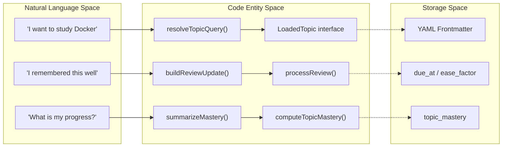
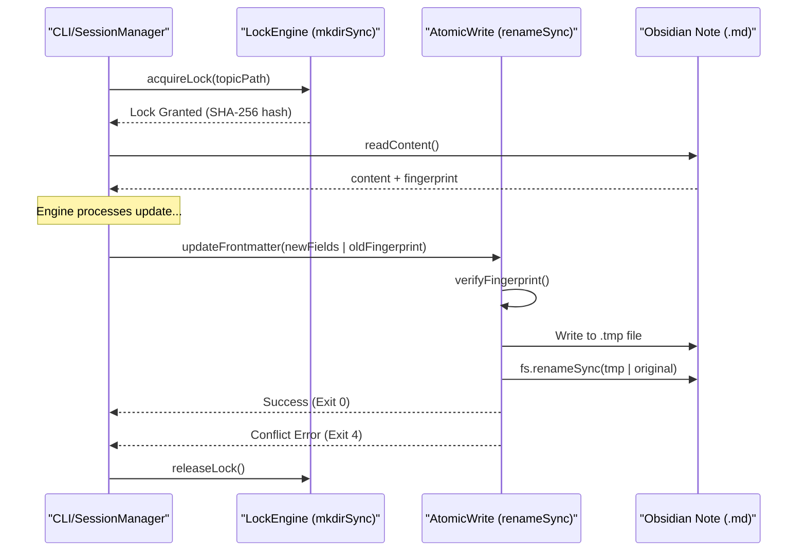

# Architecture Overview
::: details Relevant Source Files

- [README.md](https://github.com/Kuldeep2822k/cli/blob/main/README.md?plain=1)
- [package.json](https://github.com/Kuldeep2822k/cli/blob/main/package.json)
- [planning/PHASE_2_GAPS.md](https://github.com/Kuldeep2822k/cli/blob/main/planning/PHASE_2_GAPS.md?plain=1)
- [planning/palee_cli_spec.md](https://github.com/Kuldeep2822k/cli/blob/main/planning/palee_cli_spec.md?plain=1)
- [docs/adr/0008-validation-framework-decisions.md](https://github.com/Kuldeep2822k/cli/blob/main/docs/adr/0008-validation-framework-decisions.md)

:::

PALEE (Personal Active Learning & Evaluation Engine) is structured as a layered system with a strict downward dependency flow, designed to bridge deterministic learning algorithms with flexible AI-powered tutoring. The architecture prioritizes the Obsidian vault as the single source of truth, ensuring that all learning data remains human-readable, versionable, and portable [planning/palee_cli_spec.md](https://github.com/Kuldeep2822k/cli/blob/main/planning/palee_cli_spec.md?plain=1)

## System Layers

The codebase is organized into five import-reachable groups — `cli`, `application`, `validation`, `engine`, and `storage` — plus the shared `types.ts`/`index.ts` contract and the optional `ai` boundary. Dependencies point downward; the runtime layers are described below.

### 1. Storage Layer

The storage layer manages all interactions with the filesystem. It treats the Obsidian vault as the authoritative database, using Markdown frontmatter to store topic metadata [src/storage/frontmatter.ts](https://github.com/Kuldeep2822k/cli/blob/main/src/storage/frontmatter.ts)

- Atomic Writes: Ensures file integrity by writing to temporary files before renaming [src/storage/atomic-write.ts](https://github.com/Kuldeep2822k/cli/blob/main/src/storage/atomic-write.ts)
- File Locking: Prevents concurrent modification conflicts using a heartbeat-based locking mechanism [src/storage/lock.ts](https://github.com/Kuldeep2822k/cli/blob/main/src/storage/lock.ts)
- Vault Walker: Discovers and indexes topics while respecting boundary constraints (e.g., ignoring `.git`, `node_modules`) [src/storage/vault-walker.ts](https://github.com/Kuldeep2822k/cli/blob/main/src/storage/vault-walker.ts)

### 2. Engine Core

A pure-function library that contains the business logic for learning. It is decoupled from I/O to ensure testability and determinism [planning/palee_cli_spec.md](https://github.com/Kuldeep2822k/cli/blob/main/planning/palee_cli_spec.md?plain=1)

- SM-2 Algorithm: Calculates next review dates and ease factors based on recall quality [src/engine/sm2.ts](https://github.com/Kuldeep2822k/cli/blob/main/src/engine/sm2.ts)
- Dependency Graph: Manages a Directed Acyclic Graph (DAG) of topics, ensuring prerequisites are mastered before recommending advanced topics [src/engine/dependency.ts](https://github.com/Kuldeep2822k/cli/blob/main/src/engine/dependency.ts)
- Mastery Logic: Derives overall topic mastery from conceptual, practical, debug, and feynman scores [src/types.ts](https://github.com/Kuldeep2822k/cli/blob/main/src/types.ts)

### 3. Application & Validation

The application layer holds pure use-cases that coordinate storage and engine contracts without touching Commander or process state. `getNextTopics()` powers `next`, `plan`, and `dashboard`; `buildReviewUpdate()` and `buildAssessmentUpdate()` translate user input into frontmatter updates; and `summarizeMastery()` powers progress reporting.

The validation layer is the audit framework behind `palee validate`: `collectVault()`, `runRules()`, and the `rules/` registry produce structured `ValidationError` records and optional repairs.

### 4. Tool Interface & CLI

The entry point for users and external agents. It coordinates the application and validation layers, which in turn depend on storage and engine.

- CLI Interface: Commands like `palee next`, `palee plan`, and `palee review`[bin/palee.ts](https://github.com/Kuldeep2822k/cli/blob/main/bin/palee.ts)
- Session Manager: Handles the lifecycle of a study session, including "hot memory" persistence in `.palee/hot.md`[src/storage/memory.ts](https://github.com/Kuldeep2822k/cli/blob/main/src/storage/memory.ts)
- AI Module (Optional): Provides Feynman testing and tutoring, constrained by a "Human-in-the-loop" contract where the user must confirm any state changes [planning/palee_cli_spec.md](https://github.com/Kuldeep2822k/cli/blob/main/planning/palee_cli_spec.md?plain=1)

---

## Data Flow: Natural Language to Code Entities

The following diagram illustrates how high-level user actions translate into specific code entities and data structures within the PALEE ecosystem.

Diagram: Entity Mapping

Sources:[src/types.ts](https://github.com/Kuldeep2822k/cli/blob/main/src/types.ts)[src/engine/sm2.ts](https://github.com/Kuldeep2822k/cli/blob/main/src/engine/sm2.ts)[planning/palee_cli_spec.md](https://github.com/Kuldeep2822k/cli/blob/main/planning/palee_cli_spec.md?plain=1)

---

## The File-Safety Contract

PALEE implements a strict file-safety contract to ensure that automated updates never corrupt user notes. The system uses a Concrete Syntax Tree (CST) parser to modify only specific `palee_*` keys while preserving all other Markdown content, comments, and formatting [planning/palee_cli_spec.md](https://github.com/Kuldeep2822k/cli/blob/main/planning/palee_cli_spec.md?plain=1)

Diagram: Atomic Write & OCC Flow

Sources:[src/storage/atomic-write.ts](https://github.com/Kuldeep2822k/cli/blob/main/src/storage/atomic-write.ts)[src/storage/lock.ts](https://github.com/Kuldeep2822k/cli/blob/main/src/storage/lock.ts)[planning/palee_cli_spec.md](https://github.com/Kuldeep2822k/cli/blob/main/planning/palee_cli_spec.md?plain=1)[README.md](https://github.com/Kuldeep2822k/cli/blob/main/README.md?plain=1)

---

## Key Design Principles

| Principle | Implementation in Code |
| --- | --- |
| Deterministic Core | The SM-2 and dependency-graph engine modules are side-effect free and operate on plain objects [src/engine/sm2.ts](https://github.com/Kuldeep2822k/cli/blob/main/src/engine/sm2.ts)[src/engine/dependency.ts](https://github.com/Kuldeep2822k/cli/blob/main/src/engine/dependency.ts) |
| Separation of Concerns | CLI commands in `src/cli/` never call `fs` directly; they use `src/storage/` abstractions [bin/palee.ts](https://github.com/Kuldeep2822k/cli/blob/main/bin/palee.ts) |
| Vault as Source of Truth | No external database is required. The `FileCache` is strictly for performance and can be deleted at any time [src/storage/cache.ts](https://github.com/Kuldeep2822k/cli/blob/main/src/storage/cache.ts) |
| Human Oversight | AI-proposed scores must be confirmed by the user before `record_assessment` is invoked [planning/palee_cli_spec.md](https://github.com/Kuldeep2822k/cli/blob/main/planning/palee_cli_spec.md?plain=1) |

Sources:[planning/palee_cli_spec.md](https://github.com/Kuldeep2822k/cli/blob/main/planning/palee_cli_spec.md?plain=1)[README.md](https://github.com/Kuldeep2822k/cli/blob/main/README.md?plain=1)[planning/invariants.md](https://github.com/Kuldeep2822k/cli/blob/main/planning/invariants.md?plain=1)