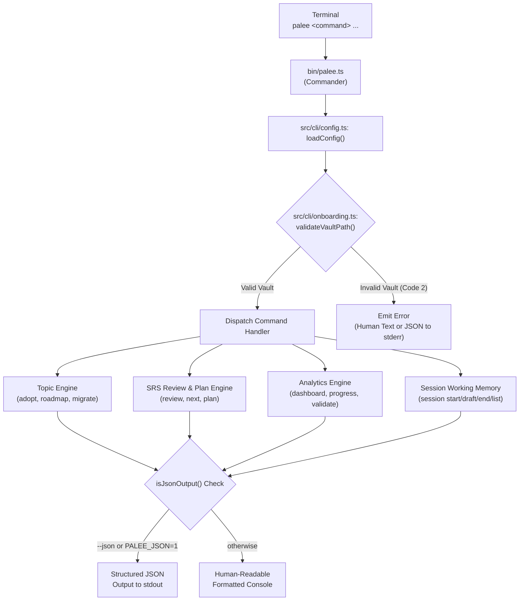

# CLI Commands

::: details Relevant Source Files

- [bin/palee.ts](https://github.com/Kuldeep2822k/cli/blob/main/bin/palee.ts)
- [src/cli/config.ts](https://github.com/Kuldeep2822k/cli/blob/main/src/cli/config.ts)
- [src/cli/onboarding.ts](https://github.com/Kuldeep2822k/cli/blob/main/src/cli/onboarding.ts)
- [src/cli/adopt.ts](https://github.com/Kuldeep2822k/cli/blob/main/src/cli/adopt.ts)
- [src/cli/review.ts](https://github.com/Kuldeep2822k/cli/blob/main/src/cli/review.ts)
- [src/cli/next.ts](https://github.com/Kuldeep2822k/cli/blob/main/src/cli/next.ts)
- [src/cli/plan.ts](https://github.com/Kuldeep2822k/cli/blob/main/src/cli/plan.ts)
- [src/cli/dashboard.ts](https://github.com/Kuldeep2822k/cli/blob/main/src/cli/dashboard.ts)
- [src/cli/progress.ts](https://github.com/Kuldeep2822k/cli/blob/main/src/cli/progress.ts)
- [src/cli/validate.ts](https://github.com/Kuldeep2822k/cli/blob/main/src/cli/validate.ts)
- [src/cli/roadmap.ts](https://github.com/Kuldeep2822k/cli/blob/main/src/cli/roadmap.ts)
- [src/cli/migrate.ts](https://github.com/Kuldeep2822k/cli/blob/main/src/cli/migrate.ts)
- [src/cli/session.ts](https://github.com/Kuldeep2822k/cli/blob/main/src/cli/session.ts)
- [src/cli/update.ts](https://github.com/Kuldeep2822k/cli/blob/main/src/cli/update.ts)
- [src/cli/update-check.ts](https://github.com/Kuldeep2822k/cli/blob/main/src/cli/update-check.ts)
- [test/cli-commands.test.ts](https://github.com/Kuldeep2822k/cli/blob/main/test/cli-commands.test.ts)
- [test/cli-exit-codes.test.ts](https://github.com/Kuldeep2822k/cli/blob/main/test/cli-exit-codes.test.ts)
- [test/cli-json-output.test.ts](https://github.com/Kuldeep2822k/cli/blob/main/test/cli-json-output.test.ts)

:::

The `palee` CLI is the primary developer interface for interacting with the PALEE learning engine. It provides a comprehensive suite of terminal commands for managing learning topics, scheduling spaced repetition reviews via SuperMemo SM-2, tracking mastery and difficulty analytics, ingesting curriculum roadmaps, and executing focused study sessions with working memory synchronization.

All commands are registered and dispatched through the central CLI entry point at [bin/palee.ts](https://github.com/Kuldeep2822k/cli/blob/main/bin/palee.ts).

---

## Command Architecture

The CLI is implemented on top of the `commander` framework. Every command follows a deterministic, four-stage lifecycle:

1. **Configuration Resolution**: Commands load persistent configuration (`PaleeConfig`) from the OS-specific config directory via `loadConfig()` [src/cli/config.ts](https://github.com/Kuldeep2822k/cli/blob/main/src/cli/config.ts).
2. **Vault Preflight Validation**: Commands verify that the configured vault path exists, is a readable directory, and contains accessible Markdown files using `validateVaultPath()` [src/cli/onboarding.ts](https://github.com/Kuldeep2822k/cli/blob/main/src/cli/onboarding.ts).
3. **Domain Engine Delegation**: Core domain logic is dispatched to dedicated command handlers (e.g., `adoptCommand`, `reviewCommand`, `planCommand`, `sessionCommand`), which interface directly with storage layers, the SM-2 engine, and the DAG dependency solver.
4. **Format & Channel Resolution**: Output is rendered to the terminal in human-readable styled text, or emitted as structured JSON when `--json` is specified or `PALEE_JSON=1` is set [src/cli/onboarding.ts](https://github.com/Kuldeep2822k/cli/blob/main/src/cli/onboarding.ts).



---

## Exit Code Contract (0 to 5)

PALEE adheres to a strict, standardized exit code contract across all 13 commands. Automated CI/CD pipelines, shell scripts, and editor plugins can rely deterministically on these exit codes:

> The binding decisions behind this contract — the single `exitCodeFor` classifier and the `process.exitCode`-never-`process.exit` flush policy — are recorded in ADR-0024. The per-command surface contracts it stabilizes live in the CLI backfill ADRs: readiness/blocked reporting (ADR-0020), the assessment surface (ADR-0021), adoption (ADR-0022), and `migrate --relabel-ties` (ADR-0023).

| Exit Code | Classification | Description | Typical Triggers |
| :---: | :--- | :--- | :--- |
| **0** | **Success / Clean Exit** | Command completed successfully, help text was printed, dry-run simulation finished, or the user gracefully cancelled an interactive prompt. | Successful review, complete roadmap import, `palee validate` passed with 0 errors, `palee adopt --dry-run`. |
| **1** | **Partial Failure** | The operation completed partially, but one or more sub-items failed (e.g. corrupt note files or I/O failure during batch import). | `palee roadmap` where some notes in the curriculum failed atomic write or directory creation (`failed > 0`); `palee session end` that recorded the session but could not delete draft checkpoints or clear `hot.md`'s active-session marker. |
| **2** | **Argument / Configuration Error** | CLI parameters are invalid, required arguments are missing, target path is outside the vault, or the vault path is unconfigured / inaccessible. | Non-integer quality rating for `review`, missing `--from` in `roadmap`, unconfigured vault path, non-interactive stdin without `-y`. |
| **3** | **Validation / Schema / Cycle Error** | Domain validation rules were violated, such as duplicate IDs, missing prerequisites, dependency cycles, or unrecognized metadata schema versions. | `palee validate` found cycles or missing IDs, `palee roadmap` contained duplicate IDs or cycles, `palee migrate` found unsupported schema. |
| **4** | **OCC Concurrency Conflict** | Optimistic Concurrency Control detected a mid-air collision (`ECONFLICT` / `isConflictError`). A note's SHA-256 fingerprint changed between reading and writing, an active file lock is held, or a lock directory holds an entry that cannot be removed. | Concurrent edits by Obsidian or external scripts during `review` (TOCTOU pre-write verification), `adopt`, `roadmap`, or `session`. |
| **5** | **Unexpected Runtime / I/O Error** | An unhandled exception occurred, such as file system permission denial, an unreadable config directory, or hardware I/O error. | Missing OS environment variables (`LOCALAPPDATA` on Windows), disk full during atomic write rollback. A syntactically corrupt `config.json` is **not** an exit-5 trigger: `loadConfig` catches the `SyntaxError`, warns, and continues with default configuration, so the command exits `0` (#326). |

### Per-Command Exit Code Reference

The following table documents the exact behavior of every command under each exit code:

Only exits a command can produce are listed; codes it never returns are omitted.

| Command | Exit | Behavior |
| :--- | :---: | :--- |
| `palee config` | 0 | Successfully printed or updated configuration; a declined interactive `set-base-url` origin confirmation (nothing written); `test-connection` reached the provider and printed its reply; a syntactically corrupt `config.json` (see the exit 5 row). |
| `palee config` | 2 | Missing value for `set-*`, unknown action, non-existent vault directory, a `set-base-url` value that is unparseable, non-HTTP(S), HTTP to a non-loopback host, or carries a query/fragment/userinfo, `set-api-key` given its key as an argument, a `set-base-url` origin change while a stored key is configured in a non-interactive or `--json` run without `--keep-key`, a confirmed interactive `set-base-url` whose stored `apiKey` or `baseUrl` changed while the confirmation prompt was open (nothing is written), `test-connection` with no usable endpoint configured, or `test-connection` rejected by the provider with `401`/`403` (the credential, not the connection, failed). |
| `palee config` | 3 | A provider reply that failed the output contract (INV-38) during `test-connection`. |
| `palee config` | 5 | Missing `LOCALAPPDATA` on Windows, or `test-connection` failing to reach the provider (timeout, refused redirect, `5xx`, or an otherwise unreachable host). A corrupt `config.json` is not an exit-5 condition (#326): `loadConfig` catches the `SyntaxError`, prints `Warning: Corrupted configuration at <path>. Falling back to default configuration.`, and the command runs on defaults and exits `0` — a script cannot detect a broken config from the exit code. |
| `palee adopt` | 0 | Single note or batch adopted, dry-run rendered, or user declined confirmation (`N`). |
| `palee adopt` | 2 | Missing/unconfigured vault, target note path escapes vault, note already adopted, a note over the 512 KiB read cap named on its own (nothing written), invalid `--difficulty`, invalid glob pattern, missing path without `--all`, a single file that batch mode cannot take (a non-markdown name, or any file passed with `--all`), or non-interactive stdin without `-y`. |
| `palee adopt` | 3 | `--auto-chain` planned dependency graph contains a cycle (reported with the exact cycle path); no notes adopted. |
| `palee adopt` | 4 | OCC conflict: the pre-write re-read found a batch note now declaring a `palee_id` (another process adopted it), left with an unclosed frontmatter opener, or grown past the 512 KiB read cap, and refused the batch with nothing written; or the atomic write's fingerprint check failed (`isConflictError`). |
| `palee adopt` | 5 | Uncaught file system exception or atomic batch rollback failure. |
| `palee next` | 0 | Successfully displayed next due topic, all due topics (`--all`), or empty vault onboarding. |
| `palee next` | 2 | Unconfigured or non-existent vault path. |
| `palee next` | 5 | Unexpected runtime exception or file read failure. |
| `palee plan` | 0 | Successfully rendered topological daily study plan or empty vault onboarding. |
| `palee plan` | 2 | Unconfigured or non-existent vault path. |
| `palee plan` | 5 | Unexpected runtime exception or graph calculation failure. |
| `palee progress` | 0 | Successfully displayed vault progress metrics, topic detail (`--topic`), or empty vault state. |
| `palee progress` | 2 | Unconfigured vault, a topic ID/title query not found for `--topic`, or an ambiguous one (every match is listed; an exact `palee_id` wins outright). |
| `palee progress` | 5 | Unexpected runtime exception or file read failure. |
| `palee review` | 0 | Successfully updated SM-2 interval, ease factor, repetition count, and `due_at`. |
| `palee review` | 2 | Quality rating not an integer `0..5`, unconfigured vault, topic not found, or ambiguous query (multiple matches). |
| `palee review` | 4 | Target note modified concurrently between prompt and write submission (`isConflictError`). |
| `palee review` | 5 | Atomic write failure or unexpected file system error. |
| `palee assess` | 0 | Assessment recorded, `topic_mastery` recomputed, and the change in what `palee plan` offers reported; a lowering that re-hides dependents also prints a warning naming them unless `--force` is given, and `--dry-run` reports the same change while writing nothing (#269). |
| `palee assess` | 2 | No pillar score given, a score outside `0..1`, a stored pillar score that cannot be read, topic not found, or ambiguous query (every match is listed). |
| `palee assess` | 4 | The note was modified, moved or deleted between its read and its write (`isConflictError`); re-run to retry. `--dry-run` performs the same re-read and compare, so it can raise this without writing anything. |
| `palee assess` | 5 | Unexpected runtime exception. |
| `palee validate` | 0 | Vault validation passed with 0 structural errors. |
| `palee validate` | 2 | Unconfigured or non-existent vault path. |
| `palee validate` | 3 | Validation errors found (duplicate `palee_id`, missing `depends_on` target, or dependency cycle). |
| `palee validate` | 5 | Unexpected runtime exception or directory walk failure. |
| `palee roadmap` | 0 | Curriculum parsed, validated, and all topics created/updated on disk. |
| `palee roadmap` | 1 | Partial batch import failure (`failed > 0` topic notes failed due to corrupt files/write errors). |
| `palee roadmap` | 2 | Missing `--from` argument, roadmap file not found, a `--from` path that is not a regular file (e.g. a directory), malformed structure (missing `topics`), or non-interactive stdin without `-y`. |
| `palee roadmap` | 3 | Roadmap validation failed (missing ID/title/path, duplicate ID/path, invalid difficulty/order, a placeholder (all-zero) topic ID, missing dependency, cycle detected); or the pre-write graph check refused the import because a note it will skip — unreadable, or one whose composed result would cross the 512 KiB read cap — would have left a cycle on disk (nothing written). |
| `palee roadmap` | 4 | OCC conflict during atomic note write (`isConflictError`). |
| `palee roadmap` | 5 | Unexpected runtime / I/O exception. |
| `palee migrate` | 0 | All notes verified to be on current schema (`palee_schema: 1`). |
| `palee migrate` | 2 | Unconfigured or non-existent vault path. |
| `palee migrate` | 3 | Unrecognized schema version found (`palee_schema` missing or $\ne 1$). |
| `palee migrate` | 4 | OCC mid-air collision or active file lock hit while writing a note during `migrate --fix`; remaining notes are still processed. |
| `palee migrate` | 5 | Unexpected runtime exception or YAML parse failure. |
| `palee session` | 0 | Session lifecycle action (`start`, `draft`, `end`, `list`) completed successfully. |
| `palee session` | 1 | Partial failure at `session end` after the session note is on disk: one or more draft checkpoints could not be deleted (`⚠ Warning: Failed to clean up N draft(s)`), or `hot.md`'s active-session marker could not be cleared — that last case exits `4` instead when the failure is an OCC conflict. Under `--json` stdout still carries the `status: "recorded"` document: the text is in `warnings[]` and the count in `draft_cleanup_failures`. |
| `palee session` | 2 | Unconfigured vault, a `start`/`draft`/`end` with no `--topic` and no active topic to continue (a refused `start` creates no new active session and prints no banner, so a following `end` still reports no active session — #546), `session end` with no active session (a preceding `start` or a topic draft is required; a bare/repeat `end` refuses rather than minting a phantom), unconfirmed drafts blocking non-interactive `session start`, an interactive draft menu that reaches end of input before every draft is answered, or unknown action. |
| `palee session` | 4 | OCC conflict during session note write or `hot.md` update (`isConflictError`). |
| `palee session` | 5 | Unexpected runtime exception or storage directory error. |
| `palee dashboard` | 0 | Successfully rendered high-level dashboard metrics or empty vault onboarding. |
| `palee dashboard` | 2 | Unconfigured or non-existent vault path. |
| `palee dashboard` | 5 | Unexpected runtime exception or calculation failure. |
| `palee update` | 0 | Already on the latest published version, `--dry-run` reported current and latest, or `npm install -g @kuldeep2822k/palee@latest` exited 0. |
| `palee update` | 2 | Commander's own usage path: an unknown option or an unexpected positional argument. |
| `palee update` | 5 | npm could not be found on PATH or run, the version query timed out or exited non-zero, its answer was not a version, or `npm install -g` exited non-zero (e.g. an unwritable global prefix, or an offline registry). |

---

## Machine-Readable Output

PALEE is built for seamless integration into developer pipelines, shell scripts, cron jobs, and editor extensions. JSON output is an explicit opt-in via `isJsonOutput()` [src/cli/onboarding.ts](https://github.com/Kuldeep2822k/cli/blob/main/src/cli/onboarding.ts):

```typescript
export function isJsonOutput(options?: { json?: boolean }): boolean {
  if (options?.json) return true;
  const env = process.env.PALEE_JSON;
  return env === '1' || env?.toLowerCase() === 'true';
}
```

### JSON Selection Rules

1. **Explicit Flag (`--json`)**: When `--json` is supplied, PALEE always outputs structured JSON to `stdout`.
2. **Environment Variable (`PALEE_JSON`)**: Setting `PALEE_JSON=1` (or `true`, case-insensitive) selects JSON output without the flag — useful for scripts and cron jobs. This check is strict: only `1` and `true` select JSON, so `PALEE_JSON=yes` does nothing. (`PALEE_DEBUG` deliberately uses a looser rule — it enables on any value except empty or `0`.)
3. **Piping Does Not Switch Formats**: Redirecting or piping `stdout` (`palee dashboard > metrics.txt`, `palee next | less`) keeps the human-readable report. This is deliberate: a redirected report stays readable, and machine consumers opt in explicitly (#357).
4. **Structured Error Emission on `stderr`**: When JSON mode is active (via `--json` or `PALEE_JSON`) and a configuration/argument error occurs, PALEE formats the error message as a JSON payload on `stderr` and exits with code `2`:
   ```bash
   $ palee validate --json
   # If vault is unconfigured:
   # stderr: {"error":"Vault path not configured. Run: palee config set-vault <path>"}
   # exit code: 2
   ```
   The same `{"error": ...}` shape is what the reading commands (`next`, `plan`, `progress`, `dashboard`, `validate`) emit on `stderr` for the unexpected-exception class, still with exit code `5` — a handler never degrades machine mode to plain text just because it failed (#325). Outside machine mode both classes stay single-line `Error: <message>` text.
   A fatal exception that escapes every handler — including an unhandled rejection or uncaught exception caught by the entry point's process-level backstops — is reported as `{"status":"error","code":5,"error":"<message>"}` on `stdout` when JSON mode is active (the command's parsed `--json` option or `PALEE_JSON`), otherwise as the bare message on `stderr`. The raw stack is never printed unless the user opts in with `PALEE_DEBUG=1` (#338), and the process ends by setting `process.exitCode` rather than calling `process.exit`, so redirected output is fully flushed and a piped caller never receives a truncated payload (#320).
5. **Deterministic Empty States**: For empty vaults (0 topics), JSON commands return valid zeroed JSON structures instead of throwing errors or exiting non-zero.

### JSON Output Schema Mapping

| Command | JSON Root Key(s) | Description | Key Fields |
| :--- | :--- | :--- | :--- |
| `palee next` | `next`, `due_count`, `total_topics` (single)<br>`due_topics[]`, `next`, `total_topics` (`--all`) | Single next topic or array of all overdue topics. | `id`, `title`, `path`, `due_at`, `mastery`, `repetition` |
| `palee plan` | `reviews_due[]`, `ready_to_learn[]`, `quarantined_cycles[]`, `quarantined_cycles_truncated`, `counts`, `total_topics` | Topological daily study plan; dependency cycles are quarantined out of `ready_to_learn` with their exact cycle paths. | `quarantined_cycles_truncated: boolean` (true when more cycles exist than the 1000-cycle reporting cap), `counts: { due, ready, quarantined, mastered, learning, new }` |
| `palee progress` | `active_topic_count`, `archived_topic_count`, `global_mastery`, `mastery_status`, `by_difficulty`, `total_reviews`, `total_repetitions`, `total_lapses` | Vault-wide learning mastery and SRS metrics. `total_repetitions` is Σ `repetition` (a failed review resets `repetition` to 0 and is not a separate review-event count); `total_reviews` is retained as a deprecated alias of the same value. | `global_mastery: 0.0..1.0`, `by_difficulty: { beginner, intermediate, advanced }` |
| `palee progress --topic <id>` | `id`, `title`, `path`, `mastery`, `difficulty`, `repetition`, `lapses`, `assessed_at`, `last_reviewed_at` | Detailed progress breakdown for a single topic. | `mastery: 0.0..1.0`, `repetition: number`, `lapses: number` |
| `palee dashboard` | `total_topics`, `mastered`, `learning`, `new`, `mastered_pct`, `reviews_due`, `by_difficulty`, `next_review` | High-level vault dashboard metrics. | `mastered_pct: number`, `next_review: { id, title, mastery, due_at }` |
| `palee validate` | `valid`, `strict`, `gated_by_warnings`, `topic_count`, `file_count`, `error_count`, `warning_count`, `errors[]`, `warnings[]` | Vault graph integrity and schema validation report. `valid` remains errors-only; `strict` reports whether `--strict` was active, and `gated_by_warnings` is true only when strict-mode warnings alone caused the non-zero exit. | `valid: boolean`, `strict: boolean`, `gated_by_warnings: boolean`, `errors/warnings: [{ type, rule_id, severity, message, file?, topic_id?, session_id?, field?, details? }]` with legacy locator keys preserved per rule (`id`+`files` for `duplicate_id`; `topic`+`missing` for `missing_dependency`; `path` for `cycle`) |
| `palee session list` | `total_confirmed`, `total_drafts`, `confirmed[]`, `drafts[]` | List of confirmed session notes and unconfirmed draft checkpoints. | `confirmed: string[]`, `drafts: string[]` |

---

## Daily Study & Review Developer Workflows

The PALEE CLI is optimized for fast, terminal-centric study routines. Below are 4 complete, copy-pasteable daily developer workflows.

### Workflow 1: Morning Discovery & Planning Loop

Start your day by evaluating your vault health and generating a topologically ordered study queue.

```bash
# 1. Check high-level vault status and mastery breakdown
palee dashboard

# 2. Inspect today's structured learning plan
palee plan

# 3. (Optional) Pipe the plan into jq to extract only ready-to-learn topics
#    (opt in with --json or PALEE_JSON=1)
palee plan --json | jq '.ready_to_learn[] | {id: .id, title: .title, difficulty: .difficulty}'

# 4. Extract total count of reviews due today for terminal prompt/status bar
DUE_COUNT=$(palee plan --json | jq '.counts.due')
echo "Reviews due today: ${DUE_COUNT}"
```

### Workflow 2: Spaced Repetition Review Loop

Work through overdue topics one at a time using SuperMemo SM-2 quality ratings.

```bash
# 1. Fetch the single highest-priority overdue topic
palee next

# 2. Open the note in your editor or Obsidian (using jq with --json to extract path)
NOTE_PATH=$(palee next --json | jq -r '.next.path')
code "$NOTE_PATH"

# 3. Review the material and self-assess recall quality (0 to 5):
#    0 = Complete blackout, 1 = Incorrect (familiar), 2 = Incorrect (easy mistake)
#    3 = Correct with serious difficulty, 4 = Correct with hesitation, 5 = Perfect recall
TOPIC_ID=$(palee next --json | jq -r '.next.id')
palee review "$TOPIC_ID" 4

# 4. View all remaining due topics in the queue
palee next --all
```

### Workflow 3: Focused Learning Session with Working Memory & Drafts

Execute a deep-work study session on a complex topic with draft recovery and working memory synchronization (`hot.md`).

```bash
# 1. Start an interactive session (recovers any orphaned drafts and prints working memory)
palee session start --interactive

# 2. While taking notes in Obsidian, capture periodic draft checkpoints
palee session draft --topic "T-20260814T120000-abcd"

# 3. Check active drafts and past sessions
palee session list

# 4. Conclude the study session (creates confirmed note, removes drafts, regenerates hot.md & index.md)
palee session end --topic "T-20260814T120000-abcd"
```

### Workflow 4: Vault Ingestion, Curriculum Import & Validation

Onboard new notes, import external structured curricula, and verify vault integrity.

```bash
# 1. Adopt an individual note with explicit difficulty and prerequisite dependencies
palee adopt "DSA/Dynamic-Programming.md" --difficulty advanced --depends-on "T-recursion,T-memoization"

# 2. Preview a batch adoption across a module directory with glob and tag filters
palee adopt "MODULES/03-kubernetes" --include "lab-*,concept-*" --tag "devops/k8s" --dry-run --verbose

# 3. Execute the batch adoption non-interactively with rollback protection
palee adopt "MODULES/03-kubernetes" --include "lab-*,concept-*" --tag "devops/k8s" -y

# 4. Import a complete structured curriculum roadmap from YAML or Markdown
palee roadmap --from "curricula/cloud-architect.yaml" -y

# 5. Chain a YAML roadmap by order, or adopt a module tree with auto-wired dependencies
palee roadmap --from "curricula/devops.yaml" --auto-chain -y
palee adopt "MODULES" --auto-chain -y

# 6. Import a roadmap written as Obsidian wikilink lists
palee roadmap --from "curricula/devops-links.md" -y

# 5. Run vault integrity verification to confirm 0 cycles or broken dependencies
palee validate
```

---

## Command Groups Overview

The PALEE CLI is divided into five focused command domains:

### 1. Topic Management Commands
Handles the ingestion, metadata injection, curriculum parsing, and schema migration for Markdown notes in the vault.
- Commands: `palee adopt`, `palee roadmap`, `palee migrate`
- See [Topic Management Commands](./02-1-topic-management-commands.md) for full flag tables, two-phase atomic batch write engines, and YAML roadmap syntax.

### 2. Review and Scheduling Commands
Drives the active recall and spaced repetition loops, utilizing the SM-2 algorithm and DAG dependency engine to calculate intervals and prerequisites.
- Commands: `palee review`, `palee next`, `palee plan`, `palee assess`
- See [Review and Scheduling Commands](./02-2-review-and-scheduling-commands.md) for SM-2 interval formulas, readiness rules, and argument constraints.

### 3. Reporting and Validation Commands
Provides comprehensive analytics, difficulty breakdowns, mastery metrics, and structural graph validation.
- Commands: `palee dashboard`, `palee progress`, `palee validate`
- See [Reporting Commands](./02-3-reporting-commands.md) for 4-pillar mastery reporting, difficulty distributions, and cycle validation.

### 4. Session Management Commands
Manages the lifecycle of focused study sessions, synchronizing working memory (`hot.md`) and session history (`.palee/sessions/`).
- Commands: `palee session start`, `palee session draft`, `palee session end`, `palee session list`
- See [Session Management Command](./02-4-session-management-command.md) for draft recovery protocols and working memory truncation rules.

### 5. Maintenance Commands
Handles machine-level configuration and upgrades of the global install.
- Commands: `palee config`, `palee update`
- `palee config` is covered in [Configuration and CLI Option Types](./05-2-configuration-and-cli-option-types.md); `palee update` is below.

---

## Update Command

`palee update` upgrades the global install by delegating to your own npm. It does not load the vault configuration, so it works on a fresh install with no vault configured.

```bash
palee update
palee update --dry-run
```

| Flag | Type | Default | Description |
|---|---|---|---|
| `--dry-run` | `boolean` | `false` | Check for a newer version; if one exists, report it and print the exact npm command that would run. Installs nothing. |

The command:

1. Queries your configured npm registry for the latest published `@kuldeep2822k/palee` version.
2. If a newer version exists, runs `npm install -g @kuldeep2822k/palee@latest` with inherited stdio. npm uses the registry, proxy, and authentication from your own `.npmrc`; PALEE never reads those settings and opens no network connection itself (ADR-0033).
3. Rewrites the update-check cache as up to date so the version you just left does not keep announcing an update. Start a new shell to pick up the new binary.

Exit codes: `0` when already current, a dry run reported, or the install succeeded; `2` for a usage error (unknown option or unexpected positional argument); `5` when npm is missing or fails, the version query times out or exits non-zero, or the registry returns an unparseable version.

There is no `--json` mode: during a real install npm owns stdout, so a machine document could not be honored (ADR-0033). Set `PALEE_NO_UPDATE_CHECK=1` to suppress the background "new version available" notice printed by other commands; otherwise it checks at most once per 24 hours and announces at most once per published version on stderr.