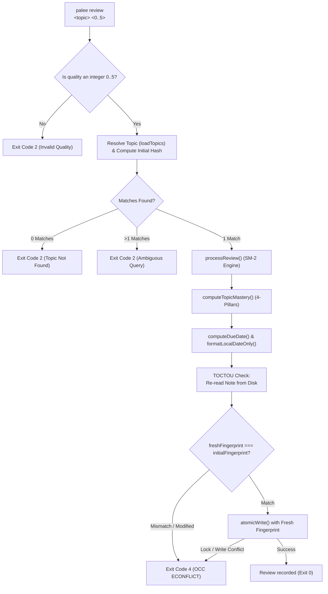

# Review and Scheduling Commands

<details>
<summary><b>Relevant Source Files</b></summary>

- [src/cli/review.ts](https://github.com/Kuldeep2822k/cli/blob/main/src/cli/review.ts)
- [src/cli/next.ts](https://github.com/Kuldeep2822k/cli/blob/main/src/cli/next.ts)
- [src/cli/plan.ts](https://github.com/Kuldeep2822k/cli/blob/main/src/cli/plan.ts)
- [src/engine/sm2.ts](https://github.com/Kuldeep2822k/cli/blob/main/src/engine/sm2.ts)
- [src/engine/dependency.ts](https://github.com/Kuldeep2822k/cli/blob/main/src/engine/dependency.ts)
- [src/engine/mastery.ts](https://github.com/Kuldeep2822k/cli/blob/main/src/engine/mastery.ts)
- [src/storage/atomic-write.ts](https://github.com/Kuldeep2822k/cli/blob/main/src/storage/atomic-write.ts)
- [test/cli-commands.test.ts](https://github.com/Kuldeep2822k/cli/blob/main/test/cli-commands.test.ts)
- [test/cli-json-output.test.ts](https://github.com/Kuldeep2822k/cli/blob/main/test/cli-json-output.test.ts)

</details>

The review and scheduling commands drive PALEE's active learning loop. They orchestrate spaced repetition calculations via the SuperMemo SM-2 algorithm, identify overdue topics, and build daily study schedules using the DAG Dependency Graph Engine.

---

## 1. Manual Review Recording (`palee review`)

The `palee review` command records active recall test results for a topic note, updating its Spaced Repetition System (SRS) state and computing the next review date (`due_at`).

### Command Syntax

```bash
palee review <topic> <quality> [--force]
```

### Arguments

| Argument | Type | Valid Values | Description | Example |
| :--- | :--- | :--- | :--- | :--- |
| `<topic>` | `string` | Non-empty string | Topic ID (e.g. `T-20260814T120000-abcd`), a unique case-insensitive title query substring, or the exact vault path the tool displayed for the note (e.g. `w/one.md`). | `"Recursion"` |
| `<quality>` | `integer` | `0`, `1`, `2`, `3`, `4`, `5` | SuperMemo recall quality rating representing recall accuracy and effort. | `4` |

### Options

| Flag | Type | Default | Description | Example |
| :--- | :--- | :--- | :--- | :--- |
| `--force` | `boolean` | `false` | Record the review without printing the early-review warning when the note's stored `due_at` is still in the future. The review is recorded and exits `0` either way; the flag only silences the notice. | `palee review "Recursion" 4 --force` |

---

### Early Reviews (#301)

`review` compares the review instant against the note's current `due_at` before
recording. When the note carries a due date and the review happens before it,
the review is **still recorded** (exit `0`), but the output names the date the
note was actually due:

```
✓ Review recorded for Recursion
  Quality: 5
  New ease factor: 2.6
  Next interval: 1 day(s)
  Due: 2026-08-25
  Repetitions: 2
  ⚠ Reviewed early - this note was not due until 2026-09-30; counting it now compounds the interval off-schedule
  Pass --force to record early reviews without this warning.
```

A note with `due_at: null` (never reviewed) has no schedule to precede and is
never treated as early, and a review on the due date itself is on schedule.
`--force` suppresses the two warning lines and nothing else. The comparison
lives in the application layer (`src/application/record-review.ts`), never in
`src/engine/sm2.ts` — `processReview` stays pure and its callers keep owning
`last_reviewed_at`/`due_at`.

---


### SuperMemo SM-2 Quality Scale

PALEE implements the standard 6-point SuperMemo recall grading scale [src/cli/review.ts#20-25](https://github.com/Kuldeep2822k/cli/blob/main/src/cli/review.ts#L20-L25):

| Quality (`q`) | Recall Classification | Effect on SM-2 Interval | Effect on Ease Factor (`EF`) |
| :---: | :--- | :--- | :--- |
| **0** | **Complete Blackout** | Resets interval to `1` day, increments `lapses`. | Decreases `EF` substantially (-0.80). |
| **1** | **Incorrect (Familiar)** | Resets interval to `1` day, increments `lapses`. | Decreases `EF` (-0.54). |
| **2** | **Incorrect (Easily Recalled)** | Resets interval to `1` day, increments `lapses`. | Decreases `EF` slightly (-0.32). |
| **3** | **Correct (Serious Difficulty)** | Advances repetition count; interval multiplied by `EF`. | Decreases `EF` moderately (-0.14). |
| **4** | **Correct (Hesitation)** | Advances repetition count; interval multiplied by `EF`. | Keeps `EF` approximately stable (0.00). |
| **5** | **Perfect Recall** | Advances repetition count; interval multiplied by `EF`. | Increases `EF` by `+0.10`. |

---

### Review State Transition Logic

When `palee review` executes [src/cli/review.ts#58-115](https://github.com/Kuldeep2822k/cli/blob/main/src/cli/review.ts#L58-L115):

1. **Topic Resolution**: Discovers candidate notes by checking exact ID matches, ID substring matches, and case-insensitive title substring matches. If multiple notes match, it lists all candidates and exits with code `2` to prevent ambiguous writes. If *nothing* matched, the query is compared once against each note's vault-relative path — `next` and `plan` print that path, so feeding the displayed identifier back is a valid lookup, not a refusal. The path comparison is exact after folding `\` to `/` (and case on Windows, where the filesystem does the same); because an ID or title hit is settled first, the path reading can never dislodge a match the learner already had (#313).
2. **SM-2 State Calculation**:
   - **Ease Factor Delta**:

     ```text
     ΔEF = 0.1 - (5 - q) * (0.08 + (5 - q) * 0.02)
     EF_new = Math.max(1.30, roundHalfUp(EF_prev + ΔEF, 4))
     ```

   - **Interval Progression**:
     - Repetition 1: `I(1) = 1` day
     - Repetition 2: `I(2) = 6` days
     - Repetition `n >= 3`: `I(n) = Math.max(1, Math.round(I(n-1) * EF))`
   - If `q < 3` (failed recall): resets interval to `1` day and increments `lapses`.
3. **Mastery & Pillar Score Sync**: Recomputes `topic_mastery` via the 4-pillar mastery formula. Pillar scores already on the note are normalized and written back unchanged; a pillar the note does not carry is **not written** (#300) — a review records the SM-2 outcome, never an assessment score the learner never gave, the same rule roadmap import (#191) and adopt (#277) follow via the shared `carriedPillarScores()` helper in [src/engine/mastery.ts](https://github.com/Kuldeep2822k/cli/blob/main/src/engine/mastery.ts).
4. **Local Date Calculation**: Computes `due_at` by adding `interval_days` calendar days to current local date (`YYYY-MM-DD`).
5. **OCC TOCTOU Race Elimination**: To eliminate Time-of-Check to Time-of-Use (TOCTOU) race windows between when the topic was initially loaded into memory and when the user finishes entering the review rating, `reviewCommand` re-reads the topic note from disk immediately prior to write:
   - Validates existence on disk.
   - Computes a fresh SHA-256 fingerprint from the newly read content.
   - Confirms `initialFingerprint === freshFingerprint`. If the note was modified on disk concurrently while awaiting user input, an `ECONFLICT` error is thrown immediately.
   - Passes the verified fresh fingerprint into `atomicWrite()`.
   - Cleanly catches concurrency errors using `isConflictError(e)` and exits with code `4`.



---

## 2. Overdue Topic Selection (`palee next`)

The `palee next` command surfaces topics currently due for review whose prerequisites are satisfied. It acts as the primary "what should I study right now?" entrypoint.

### Syntax & Options

```bash
palee next [flags]
```

| Flag | Type | Default | Description | Example |
| :--- | :--- | :--- | :--- | :--- |
| `--all` | `boolean` | `false` | Display all overdue topics in the queue instead of only the single highest-priority topic. | `palee next --all` |
| `--json` | `boolean` | `false` | Output results in structured JSON format (`PALEE_JSON=1` also works). | `palee next --json` |

---

### Prioritization & Urgency Ranking

`palee next` walks the vault, parses topic frontmatter, and sorts candidates using a strict priority order:

1. **Unreviewed Topics**: Notes with `due_at: null` or invalid dates are ranked first (highest urgency).
2. **Overdue Topics**: Topics with `due_at <= now` are sorted chronologically by oldest `due_at` date first.
3. **Future Topics**: Topics whose review date is in the future are excluded from the queue.

### Prerequisite Gating

The queue above is then filtered by the same dependency gate `palee plan` uses — the engine predicate `areDependenciesSatisfied()` [src/engine/dependency.ts](https://github.com/Kuldeep2822k/cli/blob/main/src/engine/dependency.ts) against `MASTERY_THRESHOLD` (`0.70`), shared through `findPrerequisiteBlocked()` in [src/application/get-next-topics.ts](https://github.com/Kuldeep2822k/cli/blob/main/src/application/get-next-topics.ts). `palee next` is the command a learner obeys, so it can never recommend a topic that `palee plan` reports as blocked behind an unmet prerequisite.

A due topic is withheld only when **all three** hold:

1. It is not `archived`.
2. Its own `topic_mastery` is below `0.70` — reviewing an already-mastered note breaks no prerequisite order, so such a note is always eligible.
3. A prerequisite is unmet: it is missing from the vault (a dangling reference blocks, per invariant `INV-24`) or sits below `0.70`. Advisory edges (`depends_on_source: toc` or `tie`) never gate (`INV-47`).

Topics on or downstream of a dependency cycle are **not** gated away (`INV-25`): the cycle is what got quarantined, so the gate is undefined for them, and both `next` and `plan` keep their review state real while `plan` reports the cycle under Quarantined Cycles.

When the gate withholds a topic but the queue is not empty, human output ends with a warning naming the count:

```text
⚠ 1 due topic is waiting on a prerequisite — see: palee plan
```

When the gate leaves **nothing** actionable, `palee next` says exactly that and names each blocking prerequisite with its mastery against the threshold. It never silently returns a blocked topic, and it never prints `No topics due for review.` — those notes *are* due, they are gated:

```bash
$ palee next
Nothing to review — every due topic is blocked by prerequisites:

  • BlockedChild (T-aa) — waiting on RootPrereq (T-bb) at mastery 0.0000, needs 0.70

Study the prerequisite first (see: palee plan).
```

This is a normal, empty result: exit code stays `0`.

### Example Outputs

#### Default Human-Readable Output (Single Next Topic)
```bash
$ palee next
Next topic due for review:

  Introduction to Rust
  ID: T-20260814T120000-abcd
  Due: Never reviewed
  Mastery: 0.0%
  Repetitions: 0
  Path: Rust/01-intro.md
```

#### Queue Human-Readable Output (`--all`)
```bash
$ palee next --all
2 topic(s) due for review:

  T-20260814T120000-abcd - Introduction to Rust
    Due: Never reviewed | Mastery: 0.0% | Reps: 0
    Path: Rust/01-intro.md

  T-20260814T120100-efgh - Memory Ownership
    Due: 2026-08-20 | Mastery: 45.0% | Reps: 2
    Path: Rust/02-ownership.md
```

#### JSON Output for Piping (Explicit Opt-In)

JSON output requires the explicit `--json` flag or `PALEE_JSON=1`; piping alone
keeps the human-readable report (#357).

```bash
$ palee next --json | jq .
{
  "next": {
    "id": "T-20260814T120000-abcd",
    "title": "Introduction to Rust",
    "path": "Rust/01-intro.md",
    "due_at": null,
    "mastery": 0.0,
    "repetition": 0
  },
  "due_count": 2,
  "total_topics": 15,
  "status": "ready",
  "blocked": [
    {
      "id": "T-20260814T120400-qrst",
      "title": "Unsafe Abstractions",
      "path": "Rust/04-unsafe.md",
      "mastery": 0.0,
      "waiting_on": [
        "Memory Ownership (T-20260814T120100-efgh) at mastery 0.4500, needs 0.70"
      ]
    }
  ]
}
```

`status` is the gating state (`INV-30`): `ready` when `next` names a topic, `blocked` when every candidate is waiting on a prerequisite (`next: null`, `due_count: 0`), and `nothing_due` when nothing is scheduled at all. `due_count` counts only gated-in topics, and `blocked` lists what was withheld; `status`, `blocked`, `total_topics` and `next` are present in every branch, including the empty vault, and `next --all --json` swaps `due_count` for the full `due_topics` list.

---

## 3. Daily Learning Plan (`palee plan`)

The `palee plan` command generates a comprehensive daily learning schedule, combining due reviews with new topics that have met prerequisite mastery requirements.

### Syntax & Options

```bash
palee plan [flags]
```

| Flag | Type | Default | Description | Example |
| :--- | :--- | :--- | :--- | :--- |
| `--json` | `boolean` | `false` | Output complete topological learning plan as JSON (`PALEE_JSON=1` also works). | `palee plan --json` |

---

### Dependency-Aware Readiness Engine

The plan and the review queue share one prerequisite gate. `palee plan` computes "Ready to Learn" through the DAG Dependency Graph Engine via `getReadyTopics()` [src/engine/dependency.ts](https://github.com/Kuldeep2822k/cli/blob/main/src/engine/dependency.ts), and `palee next` filters its queue through `areDependenciesSatisfied()` on that same engine and the same `MASTERY_THRESHOLD` — never a second copy of the `0.70` comparison. A note the gate holds back is therefore held back by both commands.

A topic is categorized as **"Ready to Learn"** if and only if:
1. **Unmastered**: The topic's current `topic_mastery` is strictly below the mastery threshold (`< 0.70`).
2. **Prerequisites Satisfied**: Every topic listed in its `depends_on` frontmatter array exists in the vault and has achieved `mastery >= 0.70` - unless the list is advisory, which `depends_on_source: toc` or `tie` marks: an edge that came from a README enumeration or from an equal-rank filename tie orders the plan and takes part in cycle detection, but never holds the topic out of this category.

### Plan Sections

The plan reports each note in exactly one category, in this order:
- **Quarantined Cycles** (only when a cycle exists): the canonicalized cycle paths. Topics on or downstream of a cycle have no defined learning order, so they leave "Ready to Learn"; their review schedule is still real, so they stay in "Reviews Due" (`INV-25`).
- **Reviews Due**: Topics requiring immediate spaced repetition recall **that the learner may actually study**, sorted chronologically by oldest `due_at`. A note held back by an unmet prerequisite is not reviewable and does not appear here, nor does it count in `counts.due` (#306) — a never-reviewed note with no prerequisites does appear, as `Due: Never reviewed`.
- **Ready to Learn**: New or developing topics whose prerequisites are fully satisfied, sorted by difficulty: `beginner` $\to$ `intermediate` $\to$ `advanced`.
- **Blocked by prerequisites** (only when something is blocked): every active, unmastered topic the gate withholds, each naming the prerequisite that blocks it and that prerequisite's mastery against the threshold — `• BlockedChild (T-aa) — waiting on RootPrereq (T-bb) at mastery 0.0000, needs 0.70`. A dangling reference reads `T-x is not in the vault (run palee validate)` (`INV-24`). This is the single home of a blocked note, and the same set `palee next` reports in its `blocked` field.
- **Progress Summary**: Aggregate counts of Mastered ($\ge 0.70$), Learning ($0 < M < 0.70$), and New ($M = 0$) topics.

### Example Human-Readable Output

```bash
$ palee plan
=== Today's Learning Plan ===

Reviews Due: 1
  • Memory Ownership (T-20260814T120100-efgh) - Due: 2026-08-20

Ready to Learn: 2
  • Borrowing and Lifetimes (T-20260814T120200-ijkl) - intermediate
  • Unsafe Abstractions (T-20260814T120400-qrst) - advanced

Blocked by prerequisites: 1
  • Zero-Copy FFI (T-20260814T120300-mnop) — waiting on Unsafe Abstractions (T-20260814T120400-qrst) at mastery 0.4000, needs 0.70

Progress Summary:
  Total Topics: 12
  Mastered (≥70%): 4
  Learning: 5
  New: 3
```

In `--json`, `reviews_due` and `counts.due` carry that same gated-in list, so `counts.due + counts.blocked` can no longer exceed the number of due notes; `blocked` keeps its `{ id, title, waiting_on }` item shape and its top-level key set is identical for an empty and a populated vault (INV-30).

---

## 4. Four-Pillar Assessment (`palee assess`)

`palee review` records recall quality; `palee assess` records competence. It writes pillar scores on a topic note, recomputes `topic_mastery`, and reports what that recompute did to the notes gated behind it. Mastery is what opens a prerequisite gate, and `assess` is the only command that raises it from scores the learner types — `review`, `adopt`, `roadmap` and `validate --fix` also write `topic_mastery`, but each of them *derives* it from values already on the note, and only `assess` stamps `assessed_at`. So `assess` is the one remedy a learner has for a gate they believe is wrong, and the one that can also close a gate again (see [ADR-0021](./adr/0021-assessment-surface.md) and [ADR-0009](./adr/0009-gating-model-depends-on-source.md)).

### Command Syntax

```bash
palee assess <topic> [--conceptual N] [--practical N] [--debug N] [--feynman N] [--dry-run] [--force]
```

### Arguments and Options

| Argument / Option | Type | Valid Values | Description | Example |
| :--- | :--- | :--- | :--- | :--- |
| `<topic>` | `string` | an exact `palee_id`, or a substring of one, or a case-insensitive fragment of a title, or the note's exact vault path | The topic being assessed. An exact ID wins outright, so a note called `T-math-2` cannot turn `T-math` into an ambiguity error; the path is consulted only when nothing matched by ID or title. | `"Recursion"` |
| `--conceptual <N>` | `number` | `0`..`1` | Understanding of the idea itself. | `0.8` |
| `--practical <N>` | `number` | `0`..`1` | Ability to apply it. | `0.7` |
| `--debug <N>` | `number` | `0`..`1` | Troubleshooting a broken case. | `0.6` |
| `--feynman <N>` | `number` | `0`..`1` | Explaining it from memory, in your own words. Double-weighted; see the formula below. | `0.9` |
| `--force` | `boolean` | `false` | Record the assessment without printing the notice that names the notes a lowered mastery re-hides. It is recorded and exits `0` either way; the flag only silences the notice, exactly as it does for `palee review --force` (#301, #269). | `palee assess "Recursion" --conceptual 0.3 --force` |
| `--dry-run` | `boolean` | `false` | Run the same checks a recording run runs — the vault, the topic resolution, every stored pillar, and the note re-read and fingerprint compare that can still raise `ECONFLICT` — then report the mastery transition and what it does to dependents. Takes no lock and writes no byte, so a call that would have recorded exits `0` having changed nothing (#269). | `palee assess "Recursion" --conceptual 0.3 --dry-run` |

At least one pillar option is required: `assess` with none exits `2` and prints the usage line rather than recomputing mastery from zeros. Each score must be a finite number in `0..1`; anything else exits `2`, naming the flag and the value received [src/cli/assess.ts#parsePillar](https://github.com/Kuldeep2822k/cli/blob/main/src/cli/assess.ts).

### Mastery Weighting and the `0.70` Gate

```
topic_mastery = (conceptual + practical + debug + 2 * feynman) / 5
```

rounded to four decimals [src/engine/mastery.ts#computeTopicMastery](https://github.com/Kuldeep2822k/cli/blob/main/src/engine/mastery.ts), against `MASTERY_THRESHOLD = 0.7`.

Feynman is the only double-weighted pillar, so the other three max out at `(1 + 1 + 1 + 0) / 5 = 0.60` and **cannot** reach the gate on their own. An assessment below the threshold that leaves `feynman` at `0` therefore prints the arithmetic and names `--feynman`, instead of reading as "your score was too low" (#260). The ceiling is read from the engine, not restated in the CLI, so the hint stops printing on its own if the weighting ever changes.

### Pillars You Do Not Name

A pillar you do not pass is **read, never rewritten**. Its stored value is taken as it stands, and an unusable stored score (a `feynman: 2`, say) is reported as an error and exits `2` rather than being clamped to `1` — a silent clamp would feed a mastery contribution nobody entered, which can open a gate [src/cli/assess.ts#readScoreRange](https://github.com/Kuldeep2822k/cli/blob/main/src/cli/assess.ts). Only the pillars you pass, plus `topic_mastery` and `assessed_at` (an ISO timestamp), are written to the frontmatter. The summary marks each pillar it did not touch with `(unchanged)`.

### What the Report Says About Other Notes

Raising or lowering one note's mastery changes which of its dependents are ready, so the command reports the difference in availability — counting every other topic, never the note being assessed (dropping off the ready list on being mastered is the point of the call, not a lockout):

```
✓ Assessment recorded for Recursion (T-20260814T120000-abcd)
  conceptual  0.8
  practical   0.7 (unchanged)
  debug       0.6
  feynman     0.9
  mastery     0.42 → 0.76
  Mastered (≥ 0.70).
  2 topic(s) newly offered by palee plan: T-trees, T-graphs
```

Lowering a score prints `N topic(s) are no longer offered by palee plan.`; when nothing crosses the boundary the line is `No topic changes availability; a dependent may gate on something else.`

### Seeing a Lowering Before You Commit to It

A lowered mastery closes the gate it had opened, so the notes that were ready behind it leave `palee plan`. That is reported — and it is reported in the same words whether or not anything was written:

```
✓ Assessment recorded for Strong Topic (T-strong-topic)
  conceptual  0
  practical   0
  debug       0
  feynman     0
  mastery     0.9 → 0
  Below the 0.70 threshold, so it still gates what depends on it.
  The feynman pillar is 0, and mastery is (conceptual + practical + debug + 2 * feynman) / 5, so the other three cap at 0.60 and cannot reach 0.70. Score --feynman to lift this gate.
  1 topic(s) are no longer offered by palee plan: T-001
  ⚠ Lowered from 0.9 to 0 - these notes were ready while mastery sat above 0.70; palee plan stops offering them until it rises again
  Pass --force to record a lowering assessment without this warning, or --dry-run to see it before you commit to it.
```

The warning is not a gate. `--force` drops the two lines above it and changes nothing else: the assessment is recorded and exits `0` either way, which is the same bargain `palee review --force` strikes with an early review (#301). Refusing a lowering outright would have made the honest case — a learner discovering they did not know the material — the expensive one.

`--dry-run` prints the mastery and dependent-availability output from that report, but omits the lowering warning and `--force` hint, which are printed only for a non-forced recording run. It writes nothing. The note is not locked, not modified, and its mtime does not move; but every check a recording run performs before the atomic write still runs first, including the stored-pillar reads and the note re-read with its fingerprint compare. So a preview that exits `2` or `4` is telling you the real call would have exited the same way, and a preview that says `1 topic(s) are no longer offered` is reporting the effect the write produces — both come from one code path, which is what keeps a forecast from drifting into a lie (#269). Parity ends at the write itself: the preview reports the pre-write exit result and the write's anticipated effect, but it acquires no lock, and the recording run takes the note's lock inside the atomic write, where a lock held by another process is an `ECONFLICT` in its own right. A preview that exits `0` therefore does not promise the recording run will — an active lock can still make it exit `4`.

### Concurrency

The note is re-read immediately before the write and its fingerprint compared. A note modified, moved or deleted in that window is an `ECONFLICT` — exit `4`, nothing written, re-run to retry — rather than a merge of two assessments.

---

## 5. Exit Codes for Review & Scheduling Commands

| Command | Exit Code 0 | Exit Code 1 | Exit Code 2 | Exit Code 3 | Exit Code 4 | Exit Code 5 |
| :--- | :--- | :--- | :--- | :--- | :--- | :--- |
| `palee review` | Successfully recorded SM-2 review and calculated next interval and due date; an early review (#301) also prints a warning naming the previous due date unless `--force` is given. | N/A | Quality rating not an integer `0..5`, unconfigured vault, topic not found, or ambiguous query. | N/A | OCC conflict during atomic write (`isConflictError`). | File write error or unexpected runtime exception. |
| `palee assess` | Assessment recorded, `topic_mastery` recomputed, and the availability change reported; a lowering that re-hides dependents also prints a warning naming them unless `--force` is given, and `--dry-run` reports the same effect while writing nothing (#269). | N/A | No pillar score given, a score outside `0..1`, a stored pillar score that is unusable, topic not found, or an ambiguous query (every match is listed). | N/A | The note was modified, moved or deleted between the read and the write (`ECONFLICT`); re-run to retry. A `--dry-run` reaches this too, because it performs the same re-read without writing. | Unexpected runtime exception. |
| `palee next` | Successfully displayed next due topic, all due topics (`--all`), a fully prerequisite-gated queue (`status: "blocked"`), or empty vault state. | N/A | Unconfigured or non-existent vault path. | N/A | N/A | Unexpected runtime exception or file read failure. |
| `palee plan` | Successfully displayed topological study plan or empty vault state. | N/A | Unconfigured or non-existent vault path. | N/A | N/A | Unexpected runtime exception or graph calculation failure. |