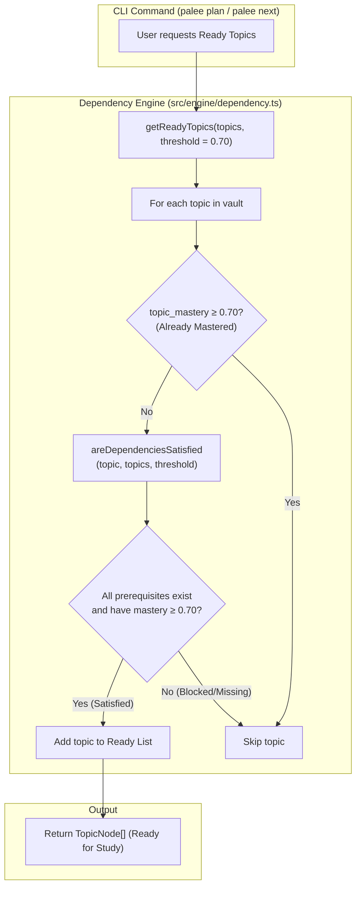
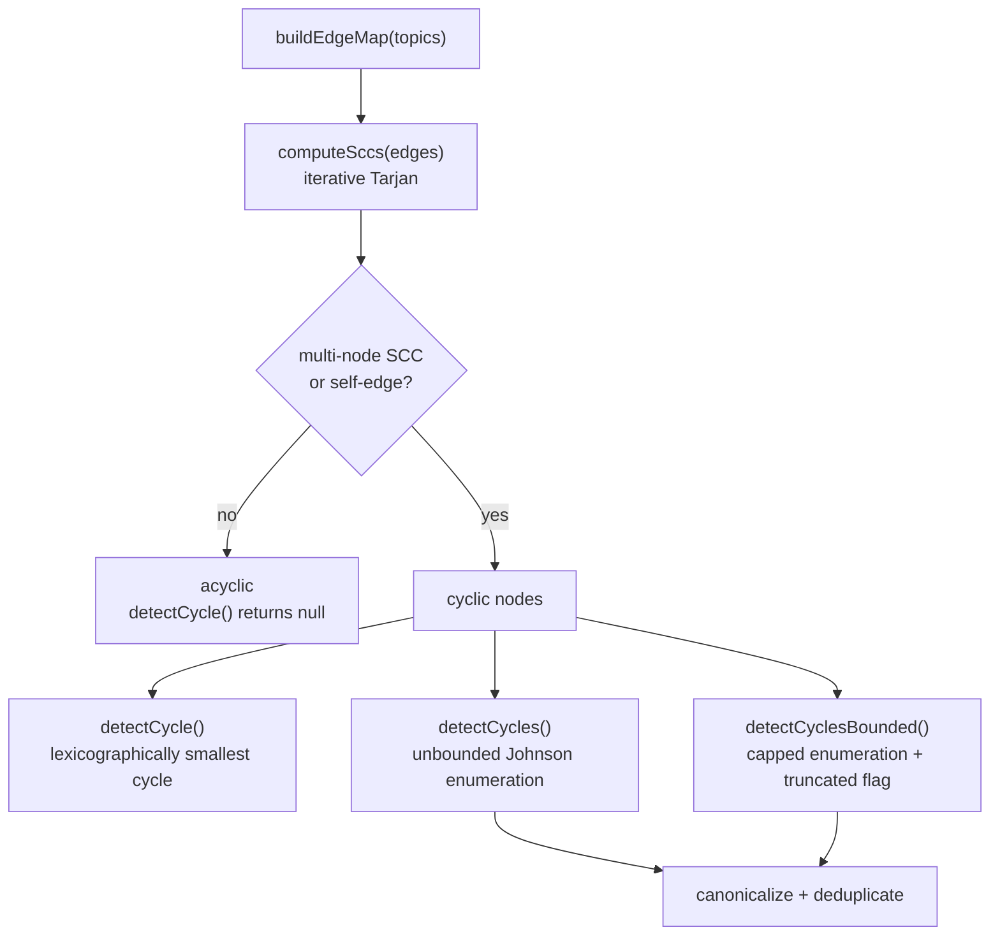
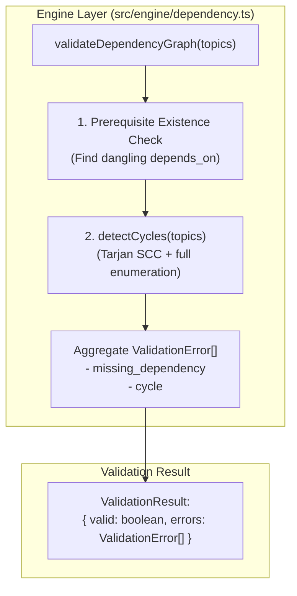

# Dependency Graph Engine
::: details Relevant Source Files

- [src/cli/validate.ts](https://github.com/Kuldeep2822k/cli/blob/main/src/cli/validate.ts)
- [src/engine/dependency.ts](https://github.com/Kuldeep2822k/cli/blob/main/src/engine/dependency.ts)
- [src/engine/index.ts](https://github.com/Kuldeep2822k/cli/blob/main/src/engine/index.ts)
- [src/engine/mastery.ts](https://github.com/Kuldeep2822k/cli/blob/main/src/engine/mastery.ts)
- [src/types.ts](https://github.com/Kuldeep2822k/cli/blob/main/src/types.ts)
- [test/engine-dependency.test.ts](https://github.com/Kuldeep2822k/cli/blob/main/test/engine-dependency.test.ts)

:::

The Dependency Graph Engine models curriculum relationships as a Directed Acyclic Graph (DAG), ensuring learners tackle foundational prerequisites before advanced concepts. It provides cycle detection built on iterative Tarjan strongly connected components (with Johnson enumeration for full diagnostics), prerequisite satisfaction evaluation against the `0.70` mastery threshold, and graph integrity validation.

---

## TopicNode Model & Dependency Extraction

The graph engine abstracts Markdown vault notes into `TopicNode` entities:

| Property | Type | Description |
|---|---|---|
| `palee_id` | `string` | Unique immutable identifier for the topic note. |
| `title` | `string` (optional) | Human-readable topic title. |
| `path` | `string` (optional) | Relative file path within the Obsidian vault. |
| `depends_on` | `string[]` (optional) | Canonical list of prerequisite `palee_id` references that must be mastered first. |
| `depends_on_source` | `string` (optional) | Who authored that list: `numbered`, `toc`, `declared` or `tie`. `toc` and `tie` are advisory - they rank a topic and take part in cycle detection but never hold it off the ready list - while an absent or unrecognized label gates, fail-closed. |
| `topic_mastery` | `number` (optional) | Floating-point mastery score in the interval $[0.0, 1.0]$. |

### Canonical Dependency Access

The engine reads prerequisite declarations from the canonical `depends_on` field only. Legacy `dependencies` aliases are accepted at the **storage boundary** — `normalizeDependencies` (`src/storage/dependencies.ts`) unions and deduplicates both fields into `depends_on` when topics are loaded (`loadTopics`) or a roadmap file is parsed (`parseRoadmapContent`). By the time topic nodes reach the engine, the graph topology is already canonical:

```typescript
// src/engine/dependency.ts
function getTopicDependencies(topic?: Partial<TopicNode> | null): string[] {
  return topic?.depends_on ?? [];
}
```

Roadmap import additionally deletes the legacy `dependencies` key from topic-note frontmatter when it rewrites a topic, so vaults converge on the canonical field over time.

---

## Mastery Threshold and Readiness Evaluation

PALEE enforces a standard threshold (`MASTERY_THRESHOLD = 0.70` or 70%) to evaluate whether prerequisites are satisfied. A topic is considered ready for immediate study only when every prerequisite topic in its dependency chain meets or exceeds this threshold.

### Dependency Satisfaction

Signature: `areDependenciesSatisfied(topic, topics, threshold = 0.70)`

Evaluates whether all prerequisite dependencies for a given topic are satisfied:

1. **Extracts Prerequisite IDs**: Resolves unique IDs using `getTopicDependencies(topic)`.
2. **Advisory Short-Circuit**: If the topic's `depends_on_source` is `toc` or `tie`, the list came from an enumeration or from an equal-rank filename tie rather than from an order anyone claimed, so the topic is satisfied regardless of those prerequisites' mastery (a target missing from the vault is still reported by `palee validate`).
3. **Missing Prerequisite Check**: If any referenced `depId` does not exist in `topics`, returns `false`.
4. **Mastery Threshold Verification**: For each prerequisite `depTopic`, if `depTopic.topic_mastery < threshold`, returns `false`.
5. Returns `true` if and only if all prerequisites exist and have `topic_mastery >= threshold`.

### Ready Topic Selection

Signature: `getReadyTopics(topics, threshold = 0.70)`

Determines the queue of unmastered topics whose prerequisites are fully satisfied:

1. Iterates over all topics in `topics.values()`.
2. **Mastery Check**: If `topic.topic_mastery >= threshold`, skips the topic (already mastered).
3. **Dependency Check**: Calls `areDependenciesSatisfied(topic, topics, threshold)`.
4. If satisfied, appends `topic` to the ready list.

### Readiness Evaluation Flowchart



---

## Cycle Detection: Tarjan SCC + Johnson Enumeration

A curriculum can only be sequenced if its prerequisite graph is acyclic. PALEE does not use a recursive three-colour DFS; cycle detection is built on strongly connected components, with an optional bounded enumeration for diagnostics.

### Stage 1: Strongly Connected Components

`computeSccs()` runs an iterative Tarjan pass over the prerequisite edge map (`buildEdgeMap`). A component with more than one node is cyclic by definition: every node in it can reach every other node. A single-node component is cyclic only when that node has a self-edge, because SCC structure alone cannot observe a self-loop.

Iterative traversal avoids call-stack limits on deep curricula, and nodes are processed in sorted order so the decomposition is deterministic.

### Stage 2: Cycle Selection and Enumeration

Three APIs serve different consumers:

- `detectCycle()` returns only the lexicographically smallest canonical cycle. It is the bounded first-cycle helper for engine callers that need a single answer; it finds that path by direct search in $O(V \cdot (V + E))$ worst case and never enumerates the full cycle set.
- `detectCycles()` returns every distinct canonical cycle without a limit. `validateDependencyGraph()` uses it when the caller needs a complete audit.
- `detectCyclesBounded()` is the same enumeration capped at `maxCycles` (default 1000). It sets `truncated` when the cap is reached; `no-dependency-cycle`, `palee roadmap`, `adopt --auto-chain`, and interactive `plan` use it so pathological graphs produce bounded output with an explicit truncation signal.

Inside a multi-node SCC, `enumerateSccCycles()` adapts Johnson's algorithm to report each elementary cycle exactly once; canonicalization rotates a cycle to start at its smallest node and deduplication removes rotations of the same loop.

`detectCycle()` returns a path that repeats its first node (for example `['T-react', 'T-hooks', 'T-react']`), and `null` means the graph is acyclic. The enumeration APIs return arrays of such paths; `detectCyclesBounded()` adds the `truncated` flag.



The split is deliberate: `validateDependencyGraph()` can take the unbounded enumeration when completeness matters, while CLI surfaces use the bounded form and report truncation instead of waiting indefinitely.

---

## Graph Integrity Validation

The `validateDependencyGraph` function is the engine's standalone curriculum-integrity audit. The CLI `palee validate` command runs the validation rule registry instead; its `no-dependency-cycle` rule uses `detectCyclesBounded()` and reports a truncation finding when the 1000-cycle cap is reached.

### Validation Pipeline Diagram



### Validation Error Catalog

| Error Type | Fields | Trigger Condition | Exit Code | Example Error Message |
|---|---|---|:---:|---|
| `missing_dependency` | `topic`, `missing` | A prerequisite ID listed in `depends_on` does not exist in the vault. | `3` | `Topic T-react depends on missing topic T-html` |
| `cycle` | `path` | Circular prerequisite reference detected by SCC analysis. | `3` | `Circular dependency detected: T-a -> T-b -> T-c -> T-a` |

---

### Auto-Chain Ordering (INV-46/47)

`adopt --auto-chain` is a batch-only boolean. `--chain-tier strict|full` selects how much of the vault is chained (default `strict`); an unknown tier, or `--chain-tier` without the flag, exits `2`.

The strict tier chains from Tier-0 hygiene over the numbered tree. Inside the hygiene planner, a directory leads with its README-class document, then numeric lessons, then `deep-dive`, `lab`, and `exam`, then remaining documents; homework (`assignment`, `quiz`, `solution`) comes last. An alphabetical transition between unnumbered sibling directories never gates: each directory opens its own chain. The public `compareLessonOrder` is unchanged. Numbered modules and, by owner ruling PAL-205-G2, the vault-root README bridge into the first numbered module at any depth, so `MODULES/01-foundations/…` qualifies the same way `01-foundations/…` does. The root README is the only root exception; a root note pointing into a directory that states no lesson number at any level still refuses to chain.

The `full` tier additionally chains what numbering does not cover, using the repository's own `README`/`SUMMARY` markdown-link enumeration. Resolution is fail-closed, fenced examples are excluded, balanced parentheses are retained, and same-directory resorting mirrors the hygiene ranks including the phase index. Acyclicity of the merged plan is asserted in code, and numbering dominance means numbered-tree endpoints always follow numeric order. An ordinary leaf may be a TOC predecessor because the enumeration states that order; excluded notes, phase subtrees, and translation demotions never are.

Each edge records who authored it in the additive `depends_on_source` field (`numbered`, `toc`, `declared`, `tie`). `toc` and `tie` edges are advisory: they rank a topic and participate in cycle detection, but never hold it off the ready list. With no numbered layout, no resolved TOC link, and zero planned edges, the CLI reports `0 edges (no numbered layout, no chainable order signal) — consider palee roadmap` and exits `0` instead of chaining alphabetically.

`roadmap --auto-chain` instead orders by `order`: unordered topics keep file order and are appended last. An edge that would close a cycle against an authored dependency is skipped with a warning rather than failing the import, and the summary counts only edges actually synthesized. A numeric prefix counts only when a separator or the end of the name follows it and it spans at most three digits, so `3d-printing.md` and `2024-recap.md` are ordinary unnumbered notes, not lessons 3 and 2024.

The adopt plan spans every note in the scanned scope — the notes being adopted plus those already adopted there — so a chain bridges onto an already-adopted note instead of restarting at the first new one. That note supplies its existing `palee_id` as the predecessor and is never rewritten, and `--dry-run` previews exactly the edges the commit would write. Notes filtered out by `--include`, `--exclude`, or `--tag` join no plan and are stepped over as predecessors too, so an excluded note is never made a `depends_on` entry. Both commands validate the planned graph for cycles before any write, reporting cycles by vault-relative path and labeling edges the flag synthesized. An explicit non-empty `depends_on` always wins.


## Invariants and Guarantees

| Invariant | Implementation Guarantee |
|---|---|
| **Acyclicity** | Curriculum must form a strict Directed Acyclic Graph (DAG). `detectCycle` returns `null`. |
| **Prerequisite Gating** | Downstream topics are locked until all direct *gating* prerequisites achieve $\ge 0.70$ mastery. A `depends_on_source` of `toc` or `tie` makes the whole edge list advisory: it still ranks the topic and takes part in cycle detection, and it never locks. |
| **Canonical Dependencies** | Legacy `dependencies` aliases are unioned and deduplicated into `depends_on` once at the storage boundary (`normalizeDependencies`); the engine consumes canonical `depends_on` only. |
| **Deterministic Traversal** | Iterative Tarjan SCC runs in $O(V + E)$; the bounded `detectCycle` wrapper is $O(V \cdot (V + E))$ and never recurses. Both visit nodes in sorted order. |
| **Auto-Chain Ordering (INV-46/47)** | Tiered ordering for `adopt --auto-chain` and `roadmap --auto-chain`. See [Auto-Chain Ordering](#auto-chain-ordering-inv-4647). |
| **Fail-Closed Wikilinks (INV-48)** | Wikilink roadmap resolution strips anchors, resolves exact paths then unique basenames, and errors (exit 3, zero writes) on ambiguous, unresolvable, or duplicated targets. |

Sources:
- Dependency Graph Engine: [src/engine/dependency.ts](https://github.com/Kuldeep2822k/cli/blob/main/src/engine/dependency.ts)
- Validation CLI Command: [src/cli/validate.ts](https://github.com/Kuldeep2822k/cli/blob/main/src/cli/validate.ts)
- Domain Types: [src/types.ts](https://github.com/Kuldeep2822k/cli/blob/main/src/types.ts)
- Graph Test Suite: [test/engine-dependency.test.ts](https://github.com/Kuldeep2822k/cli/blob/main/test/engine-dependency.test.ts)