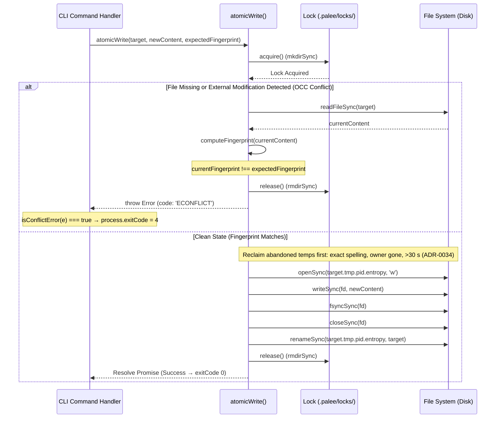
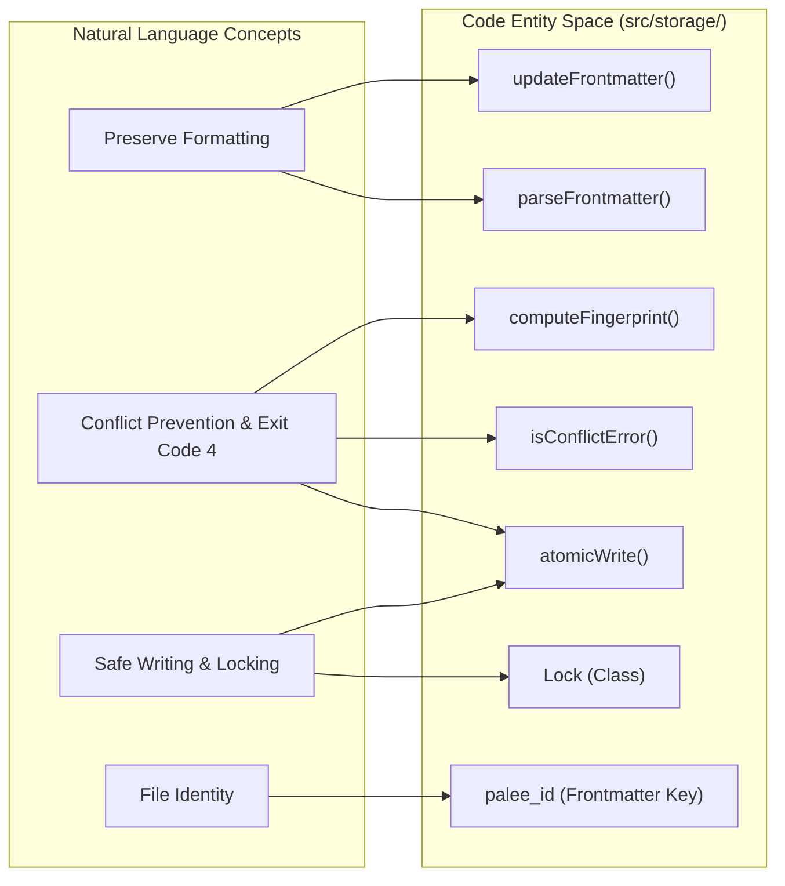

# Frontmatter Parser and Atomic Writes
::: details Relevant Source Files

- [planning/storage_design.md](https://github.com/Kuldeep2822k/cli/blob/main/planning/storage_design.md?plain=1)
- [src/storage/atomic-write.ts](https://github.com/Kuldeep2822k/cli/blob/main/src/storage/atomic-write.ts)
- [src/storage/frontmatter.ts](https://github.com/Kuldeep2822k/cli/blob/main/src/storage/frontmatter.ts)
- [src/storage/index.ts](https://github.com/Kuldeep2822k/cli/blob/main/src/storage/index.ts)
- [test/storage-atomic-write.test.ts](https://github.com/Kuldeep2822k/cli/blob/main/test/storage-atomic-write.test.ts)
- [test/storage-cache.test.ts](https://github.com/Kuldeep2822k/cli/blob/main/test/storage-cache.test.ts)
- [test/storage-frontmatter.test.ts](https://github.com/Kuldeep2822k/cli/blob/main/test/storage-frontmatter.test.ts)

:::

The Storage Layer of PALEE is designed with a "Source of Truth" philosophy where the Obsidian Markdown files are canonical [planning/storage_design.md](https://github.com/Kuldeep2822k/cli/blob/main/planning/storage_design.md?plain=1) This page details the technical implementation of how PALEE reads, modifies, and writes these files while ensuring data integrity, preserving user formatting, and handling concurrent access.

## Frontmatter Parser

The frontmatter parser in `src/storage/frontmatter.ts` is responsible for extracting and updating YAML metadata located at the top of Markdown files. Unlike standard YAML parsers that convert data into plain JavaScript objects (losing comments and formatting), PALEE uses a Concrete Syntax Tree (CST) preserving approach [src/storage/frontmatter.ts](https://github.com/Kuldeep2822k/cli/blob/main/src/storage/frontmatter.ts)

### Parsing Logic

The `parseFrontmatter` function uses a regular expression to separate the YAML block from the Markdown body [src/storage/frontmatter.ts](https://github.com/Kuldeep2822k/cli/blob/main/src/storage/frontmatter.ts) It then utilizes the `yaml` library's `parseDocument` to generate a document object that maintains the original file's structure [src/storage/frontmatter.ts](https://github.com/Kuldeep2822k/cli/blob/main/src/storage/frontmatter.ts)

### Preservation-Aware Updates

The `updateFrontmatter` function ensures that only PALEE-owned keys are modified while leaving user-defined keys (like `tags` or `cssclasses`) and comments untouched [src/storage/frontmatter.ts](https://github.com/Kuldeep2822k/cli/blob/main/src/storage/frontmatter.ts)

| Feature | Implementation Detail | Source |
| --- | --- | --- |
| Body Integrity | The Markdown body is preserved byte-for-byte during updates. | [src/storage/frontmatter.ts](https://github.com/Kuldeep2822k/cli/blob/main/src/storage/frontmatter.ts)[test/storage-frontmatter.test.ts](https://github.com/Kuldeep2822k/cli/blob/main/test/storage-frontmatter.test.ts) |
| Key Preservation | Unknown keys and reordering are prevented by mutating the CST `doc` directly. | [src/storage/frontmatter.ts](https://github.com/Kuldeep2822k/cli/blob/main/src/storage/frontmatter.ts)[test/storage-frontmatter.test.ts](https://github.com/Kuldeep2822k/cli/blob/main/test/storage-frontmatter.test.ts) |
| Comment Safety | YAML comments are retained in the raw output. | [test/storage-frontmatter.test.ts](https://github.com/Kuldeep2822k/cli/blob/main/test/storage-frontmatter.test.ts) |
| Validation | Rejects malformed frontmatter to prevent note corruption. | [src/storage/frontmatter.ts](https://github.com/Kuldeep2822k/cli/blob/main/src/storage/frontmatter.ts) |

### Fingerprinting

To support Optimistic Concurrency Control (OCC), PALEE generates a SHA-256 fingerprint of the entire file content using the `computeFingerprint` utility [src/storage/frontmatter.ts](https://github.com/Kuldeep2822k/cli/blob/main/src/storage/frontmatter.ts)

Sources: [src/storage/frontmatter.ts](https://github.com/Kuldeep2822k/cli/blob/main/src/storage/frontmatter.ts)[test/storage-frontmatter.test.ts](https://github.com/Kuldeep2822k/cli/blob/main/test/storage-frontmatter.test.ts)[planning/storage_design.md](https://github.com/Kuldeep2822k/cli/blob/main/planning/storage_design.md?plain=1)

---

## Atomic Write Protocol

The `atomicWrite` function in `src/storage/atomic-write.ts` provides a high-integrity write mechanism that prevents partial file writes, detects external modifications, and serializes concurrent operations across processes.

### Conflict Detection (Optimistic Concurrency Control)

PALEE implements an Optimistic Concurrency Control (OCC) protocol to guard against lost updates when files are edited concurrently by the user in the Obsidian GUI, background sync daemons (e.g., iCloud, Obsidian Sync, Dropbox), or parallel CLI instances.

1. **Fingerprint Verification**: When `expectedFingerprint` is supplied (calculated via `computeFingerprint` during the read phase), `atomicWrite` inspects the target file prior to any modifications:
   - If the file is missing or deleted from disk, `atomicWrite` immediately throws a `NodeError` with `code = 'ECONFLICT'` (`OCC conflict: <targetPath> does not exist (was deleted or missing)`).
   - If the file exists, `atomicWrite` reads the current file content (`fs.readFileSync(targetPath, 'utf8')`) and computes `computeFingerprint(currentContent)`.
2. **Conflict Abort**: If `currentFingerprint !== expectedFingerprint`, the target file has been modified externally since it was last read. `atomicWrite` aborts the operation and throws an error with `code = 'ECONFLICT'` (`OCC conflict: <targetPath> was modified by another process`).
3. **Disk Safety Guarantee**: On conflict detection, the lock is cleanly released in the `finally` block, and the write operation terminates immediately without creating, writing to, or renaming temporary files over the target path. The file on disk remains completely untouched.
4. **CLI Exit Code 4 Contract**: Concurrency errors are trapped across CLI command handlers (`src/cli/adopt.ts`, `src/cli/review.ts`, `src/cli/roadmap.ts`, `src/cli/session.ts`) using the `isConflictError(e)` utility:
   ```typescript
   process.exitCode = isConflictError(e) ? 4 : 5;
   ```
   An OCC mismatch or lock acquisition contention maps directly to exit code `4` (Concurrency / Conflict Error), allowing scripts and orchestrators to safely distinguish transient concurrent collisions from syntax errors (exit code 2), graph/cycle errors (exit code 3), or unhandled fatal exceptions (exit code 5).

### Atomic Replacement

To prevent file corruption during system crashes, power interruptions, or incomplete writes, PALEE never writes directly to the destination file. Instead, it follows a multi-step replacement sequence:

1. **Lock Acquisition**: Acquires an exclusive lock directory (`.palee/locks/<hash>.lockdir`) for the target path.
2. **Abandoned Temp Reclaim**: From inside the lock, and only after every applicable OCC check above has passed — the fingerprint comparison when `expectedFingerprint` is supplied, and any `expectExists` assertion, which can still reject a write that carries no fingerprint — deletes any leftover `<target>.tmp.<pid>.<entropy>` belonging to *this* target whose owner process is no longer on the host and whose age exceeds the 30-second floor, then skips and never raises on anything it cannot prove ([#481](https://github.com/Kuldeep2822k/cli/issues/481), ADR-0034). A write that omits `expectedFingerprint` applies no fingerprint check to wait on, so it still reclaims unless an `expectExists` check rejects it. A file that is young, owned by a live process, named differently, or not a regular file survives — the floor and the liveness probe together are what spare a writer on a second host sharing the same vault.
3. **Unique Temp File**: Writes the full content to a process-isolated temporary file (`<target>.tmp.<pid>.<entropy>`).
4. **Storage Flush (`fsyncSync`)**: Calls `fsyncSync` on the file descriptor to ensure data and metadata are physically committed to non-volatile storage before closing the file descriptor.
5. **Atomic Rename**: Calls `fs.renameSync` to atomically swap the temporary file over the destination file.

### Windows Retry Logic

On Windows filesystems, file locks held briefly by virus scanners, search indexers, or cloud sync clients can cause transient `EPERM` or `EBUSY` exceptions during rename. `atomicWrite` implements an exponential backoff retry loop:
- **Attempts**: Up to 5 attempts (`WINDOWS_RETRY_ATTEMPTS = 5`).
- **Initial Delay**: 50 ms (`WINDOWS_RETRY_INITIAL_DELAY = 50`), doubling each retry (`WINDOWS_RETRY_MULTIPLIER = 2`) with $\pm 25\%$ jitter (`WINDOWS_RETRY_JITTER = 0.25`), capped at 300 ms.
- **Cleanup**: If all retries are exhausted, temporary files are cleaned up (`fs.unlinkSync(tempPath)`) and the error is rethrown. This runs only on a *handled* error: a process killed by a signal reaches neither this branch nor any `finally`, because no handler exists on the write path (the only `SIGINT` listener in `src/` closes a readline prompt in `src/cli/config.ts`) — which is the residue step 2 above reclaims.

### Read Cap on the Write Paths

The reading path declines any note larger than `MAX_NOTE_SOURCE_BYTES` (512 KiB, `src/storage/source-cap.ts`), stat-first so the bound covers the IO and not only the parse. Adopting, un-adopting or importing a roadmap entry does not go through that path, so all three commands apply the same ceiling before they read:

- `adopt` and `adopt --undo` refuse a single named note with exit `2` (`ExitCode.Usage`) and write nothing; in a batch the note is skipped, named, and the rest of the batch proceeds. A note that *grows* past the cap between the scan and the pre-write re-read is a different case: it joins the drift refusal, so the whole batch aborts at exit `4`, as the exit-code tables record.
- `adopt` counts the refusals under their own `Oversized:` heading rather than under `Unreadable:`, because the shared line promises "frontmatter will not parse" and the remedy differs — an oversized file is not a note to repair.
- The cap is applied to the **result**, not only to the source. `adopt`, `adopt --undo` and `roadmap` all build the new note by adding managed frontmatter, measured at 265 bytes on the adopt path, so a source note in the last few hundred bytes below the ceiling would otherwise be written past it — the command reports success and every later read skips the topic. `noteContentExceedsReadCap` (byte length, not character count) refuses that write: exit `2` for a single note, and in a batch a named skip — with every planned edge that named the skipped note removed from the notes that depend on it, and each severed edge reported, so a batch can never write a `depends_on` pointing at a topic it did not adopt. `roadmap` folds the same verdict into its pre-write graph check instead: a topic whose composed result would cross the ceiling counts as skipped, contributing the `depends_on` its note already holds, so a skip that would leave a cycle refuses the import at exit `3` with nothing written, while one that closes no loop still costs only its own topic (exit `1`).
- `roadmap` refuses an over-cap target during validation, before any write, because the importer cannot see the `depends_on` such a note already holds and so cannot prove the graph it writes stays acyclic — the same fail-closed reading INV-46 asks for, and exit `3`. The guard in `readBoundNote` stays as defence for a note that crosses the cap mid-run; it reads `fstatSync(...).size` from the descriptor already open, so it costs no extra syscall and does not reopen the check-then-use window that function exists to close. Validation's own check reports `Topic "<id>" targets <path>. Oversized source: …`. Its wikilink format pre-reads a target before either point (`resolveWikilinkRoadmap`) and refuses an over-cap one there as `Cannot read roadmap target <path>: …`.

Without this, a note over the cap could be adopted — minting a `palee_id` onto a file every reading command skips forever — and then rewritten by `--undo`, which is the one path that would touch it again.

### Data Flow: Atomic Write Sequence



Sources: [src/storage/atomic-write.ts](https://github.com/Kuldeep2822k/cli/blob/main/src/storage/atomic-write.ts)[test/storage-atomic-write.test.ts](https://github.com/Kuldeep2822k/cli/blob/main/test/storage-atomic-write.test.ts)[planning/storage_design.md](https://github.com/Kuldeep2822k/cli/blob/main/planning/storage_design.md?plain=1)

---

## Code Entity Map

The following diagram bridges the functional requirements of the storage layer to the specific classes and functions implemented in the codebase.

### Storage Entity Mapping



Sources: [src/storage/frontmatter.ts](https://github.com/Kuldeep2822k/cli/blob/main/src/storage/frontmatter.ts)[src/storage/atomic-write.ts](https://github.com/Kuldeep2822k/cli/blob/main/src/storage/atomic-write.ts)[src/storage/lock.ts](https://github.com/Kuldeep2822k/cli/blob/main/src/storage/lock.ts)

### Atomic Write Logic Association

| System Name | Code Identifier | Role |
| --- | --- | --- |
| OCC Protocol | `expectedFingerprint` | Validates file state matches caller expectation before writing [src/storage/atomic-write.ts](https://github.com/Kuldeep2822k/cli/blob/main/src/storage/atomic-write.ts) |
| Conflict Detection | `ECONFLICT` | Error code thrown on fingerprint mismatch or missing file [src/storage/atomic-write.ts](https://github.com/Kuldeep2822k/cli/blob/main/src/storage/atomic-write.ts) |
| Exit Code 4 Mapping | `isConflictError(e)` | Identifies OCC/Lock conflict errors to set `process.exitCode = 4` [src/storage/atomic-write.ts](https://github.com/Kuldeep2822k/cli/blob/main/src/storage/atomic-write.ts) |
| CST Parser | `parseDocument` | YAML parser that maintains node positions and comments [src/storage/frontmatter.ts](https://github.com/Kuldeep2822k/cli/blob/main/src/storage/frontmatter.ts) |
| Safe Temp Path | `tempPath` | Constructed using `process.pid` to avoid collisions [src/storage/atomic-write.ts](https://github.com/Kuldeep2822k/cli/blob/main/src/storage/atomic-write.ts) |
| Backoff Strategy | `WINDOWS_RETRY_MULTIPLIER` | Factor for exponential delay between Windows retries [src/storage/atomic-write.ts](https://github.com/Kuldeep2822k/cli/blob/main/src/storage/atomic-write.ts) |
| Integrity Hash | `computeFingerprint()` | SHA-256 digest used for fingerprints and lock verification [src/storage/frontmatter.ts](https://github.com/Kuldeep2822k/cli/blob/main/src/storage/frontmatter.ts) |

Sources: [src/storage/frontmatter.ts](https://github.com/Kuldeep2822k/cli/blob/main/src/storage/frontmatter.ts)[src/storage/atomic-write.ts](https://github.com/Kuldeep2822k/cli/blob/main/src/storage/atomic-write.ts)