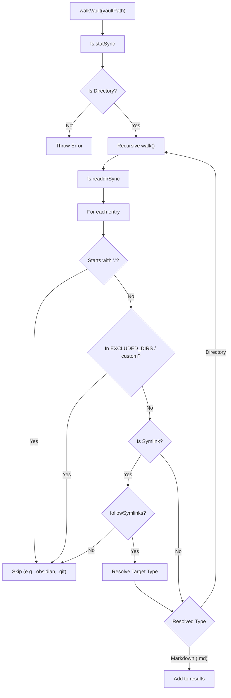
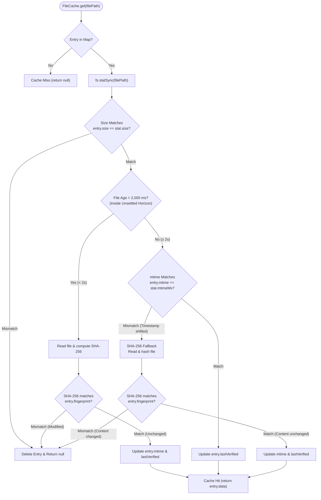
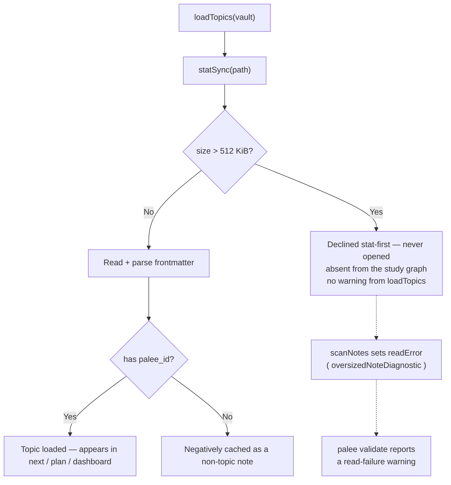

# Vault Walker and File Cache

::: details Relevant Source Files

- [src/storage/vault-walker.ts](https://github.com/Kuldeep2822k/cli/blob/main/src/storage/vault-walker.ts)
- [src/storage/cache.ts](https://github.com/Kuldeep2822k/cli/blob/main/src/storage/cache.ts)
- [src/storage/loader.ts](https://github.com/Kuldeep2822k/cli/blob/main/src/storage/loader.ts)
- [src/storage/scanner.ts](https://github.com/Kuldeep2822k/cli/blob/main/src/storage/scanner.ts)
- [src/storage/source-cap.ts](https://github.com/Kuldeep2822k/cli/blob/main/src/storage/source-cap.ts)
- [test/storage-walker.test.ts](https://github.com/Kuldeep2822k/cli/blob/main/test/storage-walker.test.ts)
- [test/storage-cache.test.ts](https://github.com/Kuldeep2822k/cli/blob/main/test/storage-cache.test.ts)
- [test/storage-loader.test.ts](https://github.com/Kuldeep2822k/cli/blob/main/test/storage-loader.test.ts)
- [test/storage-scanner.test.ts](https://github.com/Kuldeep2822k/cli/blob/main/test/storage-scanner.test.ts)

:::

The storage subsystem relies on efficient discovery of Markdown files and a robust caching mechanism to ensure performance during large-scale vault operations. The `Vault Walker` provides a filtered recursive traversal of the Obsidian vault, while the `File Cache` implements validation logic designed to handle rapid edit cycles without sacrificing data integrity.

## Vault Walker

The `walkVault` function in `src/storage/vault-walker.ts` traverses the file system and collects absolute paths to Markdown files, applying strict filtering rules:

- **Markdown Only**: Files ending in `.md` are collected, matched without regard to case — `Setup.MD` is a note. `isResolvableNotePath` folds case, so a walker that did not would hide a note from `loadTopics` while leaving it resolvable as a link and TOC target: the note gets an id minted at a path no scan lists.
- **Name Identity**: Where two spellings of one note have to meet, `foldNoteKey` case-folds and normalizes to NFC. APFS stores an accented filename decomposed (`cafe` + U+0301) while a link typed for it arrives composed, and `toLowerCase()` alone leaves those unequal — the note resolves to nothing and an accented subtree chains to no predecessor.
- **Excluded Directories**: Specifically ignores `node_modules` and any custom directories configured via `WalkOptions.excludeDirs` (e.g. `_templates`, `archive`).
- **Hidden Directories**: Any directory starting with a dot (`.`) is skipped, effectively excluding `.obsidian`, `.trash`, and `.git`.
- **Symlinks**: By default, symbolic links are skipped to prevent circular references or escaping the vault, unless explicitly enabled via `WalkOptions.followSymlinks`.
- **Permissions**: If a directory cannot be read due to permission errors (`EACCES`/`EPERM`), it is skipped safely.

### Safe Directory Creation (`ensureVaultDirectory`)

In addition to vault traversal, the vault walker module provides `ensureVaultDirectory(vaultPath, targetPath)` [src/storage/vault-walker.ts](https://github.com/Kuldeep2822k/cli/blob/main/src/storage/vault-walker.ts). This helper is utilized by commands like `palee roadmap` to create target directory structures safely:
- **Path Boundary Validation**: Checks `path.relative(resolvedVault, targetDir)` and throws an error if the path attempts directory traversal outside the vault root (`..`).
- **Symlink Escape Defense**: After creating directories, validates the canonical path using `fs.realpathSync` to guarantee that no symlink targets resolve outside the vault.
- **Lock & Idempotency Safety**: Recursively creates missing directories (`fs.mkdirSync(dir, { recursive: true })`) safely.

### Discovery Logic Flow

Sources: [src/storage/vault-walker.ts](https://github.com/Kuldeep2822k/cli/blob/main/src/storage/vault-walker.ts)[test/storage-walker.test.ts](https://github.com/Kuldeep2822k/cli/blob/main/test/storage-walker.test.ts)

---

## File Cache

The `FileCache` class in `src/storage/cache.ts` provides a deterministic in-memory store for parsed file data (such as `FrontmatterResult` or `LoadedTopic`). It is designed to minimize expensive disk I/O and SHA-256 fingerprinting operations while remaining safe against external file modifications. It contains zero test-environment bypasses (no `NODE_ENV !== 'test'` checks), guaranteeing identical deterministic behavior across testing and production.

### The Unsettled Horizon & SHA-256 Fallback

A central feature of the cache is the `UNSETTLED_HORIZON`, set to 2,000 ms (2 seconds) [src/storage/cache.ts](https://github.com/Kuldeep2822k/cli/blob/main/src/storage/cache.ts). This constant addresses the "rapid-edit cycle" and filesystem timestamp granularity issues where files might be modified multiple times in quick succession.

- **Inside Horizon (`< 2,000 ms` since `mtime`)**: The cache treats recent `mtime` values as volatile. It bypasses timestamp trust and forces a file re-read and SHA-256 hash recomputation (`computeFingerprint(content)`). If the digest matches `entry.fingerprint`, `entry.mtime` and `entry.lastVerified` are updated and cached data is returned; otherwise, the entry is evicted and `null` is returned.
- **Outside Horizon (`>= 2,000 ms` since `mtime`)**:
  - **`mtime` Match**: If `stat.mtimeMs === entry.mtime`, the file is settled and unchanged. PALEE executes a fast $O(1)$ cache hit, updating `entry.lastVerified` and returning `entry.data` without reading file contents.
  - **`mtime` Mismatch (SHA-256 Fallback)**: If `mtime` has changed outside the horizon (for example, when a file's timestamp is updated by a `touch` command, backup tool, or cloud sync without modifying note contents), `FileCache` initiates a SHA-256 fallback check. It re-reads the file and hashes its content:
    - If the SHA-256 hash matches `entry.fingerprint`, the content is confirmed identical. The cache updates `entry.mtime = stat.mtimeMs` and `entry.lastVerified = now`, preserving the cache entry and returning `entry.data`.
    - If the SHA-256 hash differs, the content has genuinely changed. The stale entry is deleted from the cache and `null` is returned.

### Cache Validation Logic

When `FileCache.get(filePath)` is called, the following validation sequence occurs:

1. **Existence & Size Verification**: If the file is not in the cache or `fs.statSync(filePath).size` differs from `entry.size`, the entry is immediately evicted (`this.cache.delete(filePath)`) and `null` is returned [src/storage/cache.ts](https://github.com/Kuldeep2822k/cli/blob/main/src/storage/cache.ts).
2. **Horizon Check**: Evaluates whether `(Date.now() - mtime) < UNSETTLED_HORIZON` [src/storage/cache.ts](https://github.com/Kuldeep2822k/cli/blob/main/src/storage/cache.ts).
3. **Fingerprint Verification**: Uses `computeFingerprint` from `src/storage/frontmatter.ts` for mandatory verification inside the horizon and as a fallback on `mtime` shifts outside the horizon [src/storage/cache.ts](https://github.com/Kuldeep2822k/cli/blob/main/src/storage/cache.ts)[src/storage/cache.ts](https://github.com/Kuldeep2822k/cli/blob/main/src/storage/cache.ts).

### Cache Validation Flowchart

Sources: [src/storage/cache.ts](https://github.com/Kuldeep2822k/cli/blob/main/src/storage/cache.ts)[test/storage-cache.test.ts](https://github.com/Kuldeep2822k/cli/blob/main/test/storage-cache.test.ts)

### Key Methods

| Method | Description | Source |
| --- | --- | --- |
| `get(filePath)` | Retrieves data if valid; performs size, horizon, mtime, and SHA-256 fallback checks | [src/storage/cache.ts](https://github.com/Kuldeep2822k/cli/blob/main/src/storage/cache.ts) |
| `set(filePath, data, fingerprint)` | Stores parsed data alongside filesystem stats (`mtime`, `size`, `lastVerified`) | [src/storage/cache.ts](https://github.com/Kuldeep2822k/cli/blob/main/src/storage/cache.ts) |
| `invalidate(filePath)` | Manually evicts a specific file entry from the cache | [src/storage/cache.ts](https://github.com/Kuldeep2822k/cli/blob/main/src/storage/cache.ts) |
| `clear()` | Flushes all entries from the in-memory cache | [src/storage/cache.ts](https://github.com/Kuldeep2822k/cli/blob/main/src/storage/cache.ts) |

Sources: [src/storage/cache.ts](https://github.com/Kuldeep2822k/cli/blob/main/src/storage/cache.ts)

---

## Two Accepted Limits of the Note Read Path

Both limits are deliberate and are preserved as-is; the obvious fix for either is worse than the limit. They
are recorded here so a user hitting one does not have to read the source to find out it is expected, and they
are pinned by tests so an edit that changes either behaviour fails loudly. The full reasoning is in
[ADR-0018](./adr/0018-read-path-caching-and-locking.md).

### A note over the read cap is dropped from the study graph, and `loadTopics` does not say so

`loadTopics` declines any file larger than `MAX_NOTE_SOURCE_BYTES` (512 KiB) with a `stat` alone — the file is
never opened. That is what keeps a generated index or an exported log from being read and YAML-parsed on every
scan, but it applies regardless of content: an oversized file that does carry a `palee_id` is not loaded, so it
is absent from `next`, `plan`, `dashboard` and `progress`, and the commands that call `loadTopics` print no
warning about it. By the time the size is known the file has not been read, so the loader cannot tell an
oversized *note* from an oversized non-note.

The decline is reported where a diagnostic is actionable:

- `scanNotes` sets `readError` on the declined entry, using `oversizedNoteDiagnostic`, which names both the
  observed size and the ceiling — so "too large to read" is distinguishable from "could not be read".
- `palee validate` surfaces it as a `read-failure` warning (`Could not read <path>: Oversized source: …`), and
  its output notes that validation ran on an incomplete snapshot.

If a topic you expect is missing from `palee plan` and `palee next`, check its size before anything else.
A note exactly at the ceiling is still read; the cap is inclusive.

Two follow-on points are worth stating, because both look like bugs and neither is one:

- The oversized file is *not* recorded in the non-topic cache. A declined read leaves no verdict behind, so
  shrinking the file below the cap makes it a topic again on the very next scan, with no cache clearing.
- `palee validate` reporting the file while `loadTopics` stays quiet is the intended split, not a
  contradiction: validation is the diagnostic surface, the study commands are not.

Sources: [src/storage/loader.ts](https://github.com/Kuldeep2822k/cli/blob/main/src/storage/loader.ts)[src/storage/source-cap.ts](https://github.com/Kuldeep2822k/cli/blob/main/src/storage/source-cap.ts)[test/storage-loader.test.ts](https://github.com/Kuldeep2822k/cli/blob/main/test/storage-loader.test.ts)

### A swallowed heading before a `key: value`-shaped line is not reported as unclosed frontmatter

`scanNotes` flags a missing closing fence by finding Markdown body text inside the frontmatter block. A
`## Subheading` line inside that block is legal YAML — a `#` starts a comment however many hashes follow — so
the scanner decides by *position*: a heading counts as leaked body text only when a column-0 blank line has
already ended the mapping **and** no YAML data line follows it. Against the closing `---`, that is the signature
of a note whose real closing fence is missing and whose `---` is a thematic break.

Two residual shapes fall outside that rule, in opposite directions:

| Frontmatter | Reported? | Why |
| --- | --- | --- |
| `\n## Subheading\n---` | Yes, unclosed | Trailing heading against the fence, no data line after it — the swallowed-body signature |
| `\n## Subheading\nfoo: bar\n---` | **No** | The `foo: bar` line is data-shaped, so the block reads as still running and the heading no longer looks trailing |
| `## reviewed 2026-01-01` directly under the entries | No | A plain YAML comment among the entries, which is how frontmatter comments are written |
| `\n## reviewed 2026-01-01\n---` | Yes, unclosed | The same layout as the first row — blank line, then a heading-shaped line against the fence — so it is reported too, though it is legal YAML |

The point of the table is that the **heading line itself** (`## …`) is byte-for-byte the same whether it is a legal YAML comment or a Markdown heading; only what surrounds it differs. Rows 1 and 4 are the same *layout* (blank line, then a heading-shaped line against the closing `---`) and are both reported — row 4 is a legal comment that gets over-reported. Row 2 is that layout with a `key: value` line after the heading, which makes the block read as still running, so it is not reported; row 3 is the same heading text placed among the entries with no blank line, which is plainly a comment. Position — the only signal available — is what separates them, and the parser cannot distinguish a comment between mapping entries from a swallowed body without a closing fence, which is exactly what is missing. The chosen direction fails safe: the
unreported shape still parses, so the note keeps its metadata and only the *warning* is lost. Widening the rule
to catch it would re-introduce the false positives the position test exists to eliminate.

Sources: [src/storage/scanner.ts](https://github.com/Kuldeep2822k/cli/blob/main/src/storage/scanner.ts)[test/storage-scanner.test.ts](https://github.com/Kuldeep2822k/cli/blob/main/test/storage-scanner.test.ts)
