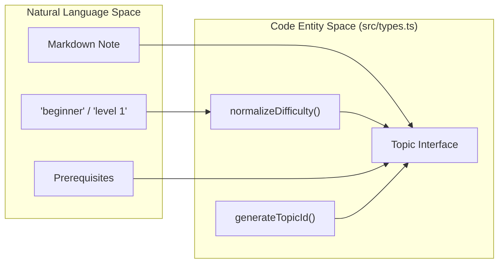
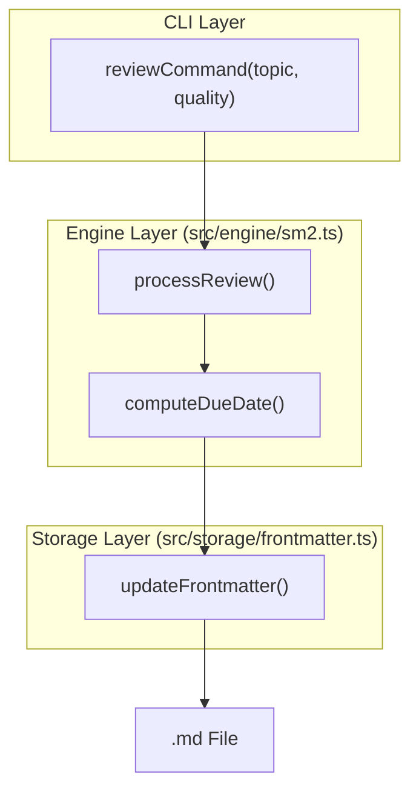

# Topic and Assessment Schema
::: details Relevant Source Files

- [examples/Docker Fundamentals.md](https://github.com/Kuldeep2822k/cli/blob/main/examples/Docker%20Fundamentals.md?plain=1)
- [examples/Docker Networking.md](https://github.com/Kuldeep2822k/cli/blob/main/examples/Docker%20Networking.md?plain=1)
- [examples/Docker Volumes.md](https://github.com/Kuldeep2822k/cli/blob/main/examples/Docker%20Volumes.md?plain=1)
- [src/cli/adopt.ts](https://github.com/Kuldeep2822k/cli/blob/main/src/cli/adopt.ts)
- [src/cli/config.ts](https://github.com/Kuldeep2822k/cli/blob/main/src/cli/config.ts)
- [src/cli/review.ts](https://github.com/Kuldeep2822k/cli/blob/main/src/cli/review.ts)
- [src/types.ts](https://github.com/Kuldeep2822k/cli/blob/main/src/types.ts)
- [test/cli-commands.test.ts](https://github.com/Kuldeep2822k/cli/blob/main/test/cli-commands.test.ts)
- [test/types-difficulty.test.ts](https://github.com/Kuldeep2822k/cli/blob/main/test/types-difficulty.test.ts)

:::

The PALEE system utilizes a structured data model to track learning progress, mastery levels, and spaced-repetition schedules for individual topics within a Markdown-based vault. This data is primarily stored as YAML frontmatter within each topic's Markdown file.

## 1. The Topic Interface

The `Topic` interface is the central entity in the system, representing a single unit of learning. It encapsulates metadata, pedagogical configuration, and nested objects for mastery and scheduling.

### Key Attributes

- `palee_schema`: An integer versioning the metadata structure (currently `1`) [src/types.ts](https://github.com/Kuldeep2822k/cli/blob/main/src/types.ts)
- `palee_id`: A unique identifier generated during adoption, typically following the pattern `T-YYYYMMDDTHHMMSS-xxxx`[src/cli/adopt.ts](https://github.com/Kuldeep2822k/cli/blob/main/src/cli/adopt.ts)
- `status`: Tracks the learning lifecycle (`not_started`, `learning`, `paused`, `archived`) [src/types.ts](https://github.com/Kuldeep2822k/cli/blob/main/src/types.ts)
- `difficulty`: A normalized categorization of the topic's complexity [src/types.ts](https://github.com/Kuldeep2822k/cli/blob/main/src/types.ts)
- `dependencies`: An array of `palee_id` strings representing prerequisite topics [src/types.ts](https://github.com/Kuldeep2822k/cli/blob/main/src/types.ts)
- `depends_on_source`: Records which tier authored `depends_on` — `numbered` from the note's own numeric prefix, `declared` from links in its `## Prerequisites` section, `toc` from a listing document's enumeration order, or `tie` from a filename collation between two notes at the same rank. It is the field that decides gating: `toc` and `tie` are advisory (they still rank the topic and take part in cycle detection, but never hold it off the ready list), while any other label — including an absent or unrecognized one — gates fail-closed [src/types.ts](https://github.com/Kuldeep2822k/cli/blob/main/src/types.ts)

### Topic Data Flow

The following diagram illustrates how natural language concepts map to the `Topic` code entity during the `adopt` process.

Natural Language to Code Entity: Topic Adoption



Sources:[src/types.ts](https://github.com/Kuldeep2822k/cli/blob/main/src/types.ts)[src/cli/adopt.ts](https://github.com/Kuldeep2822k/cli/blob/main/src/cli/adopt.ts)[src/cli/adopt.ts](https://github.com/Kuldeep2822k/cli/blob/main/src/cli/adopt.ts)

---

## 2. Four-Pillar Assessment Model

```text
topic_mastery = round((conceptual + practical + debug + 2 * feynman) / 5, 4)
```

Feynman technique evaluation carries double weighting (40%) to prioritize true conceptual articulation.

| Field | Type | Description |
| --- | --- | --- |
| `conceptual` | `number` | Understanding of theoretical principles (0.0 to 1.0). |
| `practical` | `number` | Ability to apply knowledge in a hands-on context (0.0 to 1.0). |
| `debug` | `number` | Proficiency in identifying and fixing errors in the topic area (0.0 to 1.0). |
| `feynman` | `number` | Ability to explain the topic simply to others (0.0 to 1.0, 40% weight). |
| `assessed_at` | `string \| null` | ISO timestamp of the last assessment update. |

Sources:[src/types.ts](https://github.com/Kuldeep2822k/cli/blob/main/src/types.ts)[planning/invariants.md](https://github.com/Kuldeep2822k/cli/blob/main/planning/invariants.md?plain=1)[examples/Docker Fundamentals.md](https://github.com/Kuldeep2822k/cli/blob/main/examples/Docker%20Fundamentals.md?plain=1)

---

## 3. Review (SRS) State

The `Review` object stores the Spaced Repetition System (SRS) state, implementing the SM-2 algorithm logic. Unlike the assessment pillars, these fields are updated via the `palee review` command.

### SRS Fields

- `ease_factor`: The multiplier for the next interval (default `2.5`, minimum `1.3`) [src/types.ts](https://github.com/Kuldeep2822k/cli/blob/main/src/types.ts)
- `interval_days`: The number of days until the next review [src/types.ts](https://github.com/Kuldeep2822k/cli/blob/main/src/types.ts)
- `repetition`: Count of consecutive successful reviews [src/types.ts](https://github.com/Kuldeep2822k/cli/blob/main/src/types.ts)
- `lapses`: Count of failed reviews (quality < 3) on learned topics [src/types.ts](https://github.com/Kuldeep2822k/cli/blob/main/src/types.ts)
- `last_quality`: The most recent recall quality rating (0–5) [src/types.ts](https://github.com/Kuldeep2822k/cli/blob/main/src/types.ts)
- `last_reviewed_at`: A date-only string (`YYYY-MM-DD`) recording when the topic was last reviewed [src/types.ts](https://github.com/Kuldeep2822k/cli/blob/main/src/types.ts)
- `due_at`: A date-only string (`YYYY-MM-DD`) indicating when the topic is next due for review [src/types.ts](https://github.com/Kuldeep2822k/cli/blob/main/src/types.ts)

Review State Transition Logic



Sources:[src/cli/review.ts](https://github.com/Kuldeep2822k/cli/blob/main/src/cli/review.ts)[src/engine/sm2.ts](https://github.com/Kuldeep2822k/cli/blob/main/src/engine/sm2.ts)[src/types.ts](https://github.com/Kuldeep2822k/cli/blob/main/src/types.ts)

---

## 4. Difficulty Normalization

The system provides a robust `normalizeDifficulty` function to handle varied user inputs from the CLI or roadmap imports, ensuring the internal `Difficulty` type remains consistent.

| Input Type | Input Value | Resulting `Difficulty` |
| --- | --- | --- |
| String | "beginner", "BEGINNER", " 1 " | `beginner` |
| String | "intermediate", "2", "3" | `intermediate` |
| String | "advanced", "4", "5" | `advanced` |
| Number | `<= 1` | `beginner` |
| Number | `2` or `3` | `intermediate` |
| Number | `>= 4` | `advanced` |
| Unknown | `null`, `undefined`, "expert" | `intermediate` (Fallback) |

Sources:[src/types.ts](https://github.com/Kuldeep2822k/cli/blob/main/src/types.ts)[test/types-difficulty.test.ts](https://github.com/Kuldeep2822k/cli/blob/main/test/types-difficulty.test.ts)

---

## 5. Frontmatter Mapping

When a file is adopted or updated, the `paleeData` record is serialized into the Markdown frontmatter. The `palee adopt` command initializes these values to their defaults.

```
// Initial state during adoption
const paleeData: Record<string, unknown> = {
  palee_id: topicId,      // Generated T-ID
  palee_schema: 1,
  difficulty,             // User provided or 'intermediate'
  depends_on: dependsOn,  // Array of T-IDs
  topic_mastery: 0.0,
  conceptual: 0.0,
  practical: 0.0,
  debug: 0.0,
  feynman: 0.0,
  assessed_at: null,
  ease_factor: 2.5,
  interval_days: 1,
  repetition: 0,
  lapses: 0,
  last_quality: null,
  last_reviewed_at: null,
  due_at: null,
};
```

Sources:[src/cli/adopt.ts](https://github.com/Kuldeep2822k/cli/blob/main/src/cli/adopt.ts)[examples/Docker Fundamentals.md](https://github.com/Kuldeep2822k/cli/blob/main/examples/Docker%20Fundamentals.md?plain=1)

`depends_on_source` is deliberately absent from that initial record: adoption writes no provenance label, so an adopted note's edges gate until a chaining tier stamps one. `adopt --auto-chain` and `roadmap --auto-chain` add the key, and `migrate --relabel-ties` rewrites a `numbered` label to `tie` without touching `depends_on`. A note carrying no label at all is the fail-closed spelling, which is why `migrate --relabel-ties` treats it as a separate population behind `--include-unlabeled-ties`.