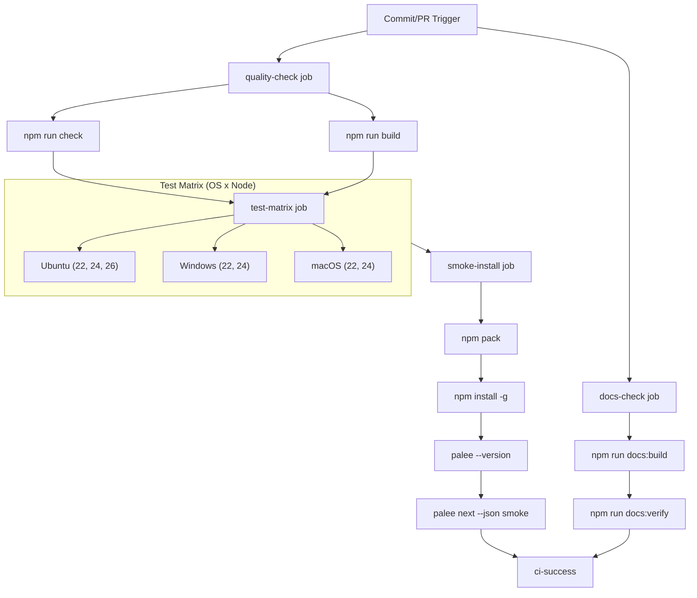
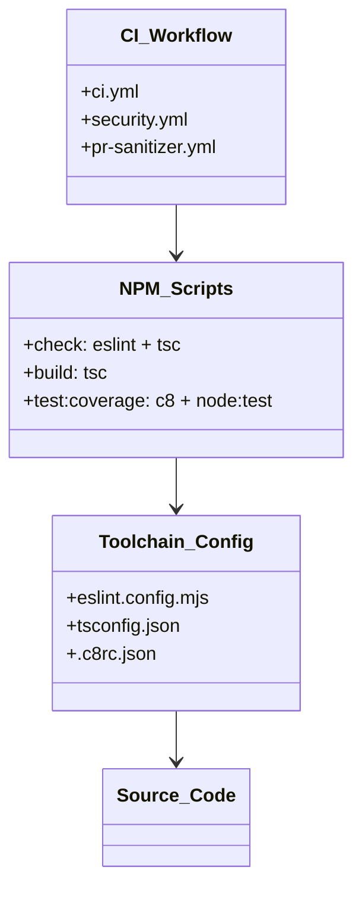

# Continuous Integration
::: details Relevant Source Files

- [.c8rc.json](https://github.com/Kuldeep2822k/cli/blob/main/.c8rc.json)
- [.github/PULL_REQUEST_TEMPLATE.md](https://github.com/Kuldeep2822k/cli/blob/main/.github/PULL_REQUEST_TEMPLATE.md?plain=1)
- [.github/labeler.yml](https://github.com/Kuldeep2822k/cli/blob/main/.github/labeler.yml)
- [.github/labels.yml](https://github.com/Kuldeep2822k/cli/blob/main/.github/labels.yml)
- [.github/workflows/ci.yml](https://github.com/Kuldeep2822k/cli/blob/main/.github/workflows/ci.yml)
- [.github/workflows/pr-labeler.yml](https://github.com/Kuldeep2822k/cli/blob/main/.github/workflows/pr-labeler.yml)
- [.github/workflows/pr-sanitizer.yml](https://github.com/Kuldeep2822k/cli/blob/main/.github/workflows/pr-sanitizer.yml)
- [.github/workflows/security.yml](https://github.com/Kuldeep2822k/cli/blob/main/.github/workflows/security.yml)
- [.github/workflows/sync-labels.yml](https://github.com/Kuldeep2822k/cli/blob/main/.github/workflows/sync-labels.yml)
- [LICENSE](https://github.com/Kuldeep2822k/cli/blob/main/LICENSE)
- [eslint.config.mjs](https://github.com/Kuldeep2822k/cli/blob/main/eslint.config.mjs)
- [renovate.json](https://github.com/Kuldeep2822k/cli/blob/main/renovate.json)

:::

The PALEE Continuous Integration (CI) infrastructure ensures code quality, cross-platform compatibility, and security through automated workflows. The pipeline validates every commit and Pull Request (PR) against strict linting rules, type checks, unit tests, and smoke tests across Linux, Windows, and macOS.

## CI Workflow Implementation

The primary CI pipeline is defined in `.github/workflows/ci.yml` and is triggered on pushes and pull requests to the `main` branch [.github/workflows/ci.yml](https://github.com/Kuldeep2822k/cli/blob/main/.github/workflows/ci.yml) It utilizes a concurrency group to cancel in-progress runs for the same PR, optimizing resource usage [.github/workflows/ci.yml](https://github.com/Kuldeep2822k/cli/blob/main/.github/workflows/ci.yml)

### 1. Quality Check Job

This job performs static analysis and build verification on `ubuntu-latest` using Node.js 24.x [.github/workflows/ci.yml](https://github.com/Kuldeep2822k/cli/blob/main/.github/workflows/ci.yml)

- Lint & Typecheck: Executes `npm run check`, which combines ESLint rules and TypeScript strict type checking [.github/workflows/ci.yml](https://github.com/Kuldeep2822k/cli/blob/main/.github/workflows/ci.yml)
- Production Build: Runs `npm run build` to ensure the project can be bundled without errors [.github/workflows/ci.yml](https://github.com/Kuldeep2822k/cli/blob/main/.github/workflows/ci.yml)

### 2. Test Matrix Job

To ensure the CLI remains stable across environments, the `test-matrix` job runs the unit and invariant test suites across multiple operating systems and Node.js versions [.github/workflows/ci.yml](https://github.com/Kuldeep2822k/cli/blob/main/.github/workflows/ci.yml)

The matrix is **one list for every event** — a pull request, a push to `main`, and a release tag all run the same seven legs. It used to be conditional on `github.event_name`: pull requests ran ubuntu 22.x/24.x plus windows 24.x only, while a push to `main` additionally ran ubuntu 26.x, windows 22.x and both macOS legs. The legs that broke were therefore the legs no pull request ever ran — [#269](https://github.com/Kuldeep2822k/cli/issues/269) attributes the merges between `v0.5.2` and `v0.6.0` that left `main` red or unverified to macOS suites (heap limit, case-fold and symlink). `test/ci-workflow-matrix.test.ts` is the fitness function that keeps the two paths from diverging again.

| Environment | Versions | Condition |
| --- | --- | --- |
| Ubuntu | 22.x, 24.x, 26.x | Always, on PRs and pushes alike |
| Windows | 22.x, 24.x | Always |
| macOS | 22.x, 24.x | Always |

- Coverage: Tests are executed via `npm run test:coverage`[.github/workflows/ci.yml](https://github.com/Kuldeep2822k/cli/blob/main/.github/workflows/ci.yml)
- PR Coverage Guard: For PRs on Ubuntu/Node 24.x, the `diff-cover` tool ensures that new or changed code maintains at least 50% coverage relative to `origin/main`[.github/workflows/ci.yml](https://github.com/Kuldeep2822k/cli/blob/main/.github/workflows/ci.yml)

### 3. Global Smoke Test

The `smoke-install` job verifies the integrity of the NPM package by simulating a global installation on ubuntu, windows and macOS alike, on a pull request rather than only after the merge [.github/workflows/ci.yml](https://github.com/Kuldeep2822k/cli/blob/main/.github/workflows/ci.yml)

1. Pack: Creates a `.tgz` tarball using `npm pack`[.github/workflows/ci.yml](https://github.com/Kuldeep2822k/cli/blob/main/.github/workflows/ci.yml)
2. Verify: Runs `scripts/verify-tarball.js` to assert the contents of the package [.github/workflows/ci.yml](https://github.com/Kuldeep2822k/cli/blob/main/.github/workflows/ci.yml)
3. Install: Installs the CLI globally from the local tarball [.github/workflows/ci.yml](https://github.com/Kuldeep2822k/cli/blob/main/.github/workflows/ci.yml)
4. Version Match: Compares `palee --version` output against the `package.json` version [.github/workflows/ci.yml](https://github.com/Kuldeep2822k/cli/blob/main/.github/workflows/ci.yml)
5. Real Command: Runs `scripts/smoke-installed.js`, which executes `palee next --json` against an isolated temporary vault and asserts the documented empty-state JSON contract [.github/workflows/ci.yml](https://github.com/Kuldeep2822k/cli/blob/main/.github/workflows/ci.yml)

### Data Flow: CI Pipeline Execution

### Workspace Isolation for CI Performance

The four CLI jobs in `ci.yml` use `npm ci --ignore-scripts --no-workspaces` to skip installing the docs workspace (`vitepress`, `mermaid`, `mathjax-full`, etc.). The separate `docs-check` job installs the docs workspace and runs `npm run docs:build` plus `npm run docs:verify`. `deploy-docs.yml` builds the published site; `release.yml` and `security.yml` still run a full `npm ci --ignore-scripts` without `--no-workspaces`.

#### Performance Impact

| Metric | Without `--no-workspaces` | With `--no-workspaces` | Improvement |
|---|---|---|---|
| `npm ci` time (local SSD) | 24.5s | 7.7s | 3.2x faster |
| `npm ci` time (CI Linux/macOS) | ~20-25s | ~2-5s | ~15-20s saved |
| `npm ci` time (CI Windows) | ~30-40s | ~5-8s | ~25-32s saved |
| Packages installed | 296 | 119 | 177 fewer |
| node_modules size | 394M | 80M | ~314M reduced |
| Docs-only deps skipped | 0M | ~200M | 200M avoided |

#### Docs-Only Dependencies Skipped

| Package | Size | Type |
|---|---|---|
| mermaid | 83M | Direct (docs devDep) |
| @mermaid-js/* | 38M | Transitive (mermaid) |
| mathjax-full | 38M | Transitive (markdown-it-mathjax3) |
| @algolia/search-docsearch | 21M | Transitive (vitepress) |
| @shikijs/* | 11M | Transitive (vitepress) |
| speech-rule-engine | 8M | Transitive (mathjax-full) |

#### Estimated CI Time Savings Per PR Run

| CI Job | Before | After | Saved |
|---|---|---|---|
| Lint, Typecheck & Build | 30s | ~27s | ~3s |
| Test (per OS/Node leg) | 3m48s-6m26s | 3m45s-6m22s | ~3-4s |
| Smoke tests (per OS) | 21s-46s | ~18s-42s | ~3s |
| Engine floor | 21s | ~18s | ~3s |
| **Total wall-clock (longest)** | **6m26s** | **~6m22s** | **~4s** |
| **Total compute-seconds** | **~2,960s** | **~2,750s** | **~210s** |

The following diagram illustrates the progression of a commit through the CI pipeline.

CI Pipeline Logic Flow

Sources:[.github/workflows/ci.yml](https://github.com/Kuldeep2822k/cli/blob/main/.github/workflows/ci.yml)

## PR Automation and Hygiene

### Labeling and Sanitization

The repository uses automated labeling to categorize changes and enforce contribution standards.

- PR Sanitizer: Validates that PR titles follow the Conventional Commits specification (e.g., `feat:`, `fix:`, `chore:`) [.github/workflows/pr-sanitizer.yml](https://github.com/Kuldeep2822k/cli/blob/main/.github/workflows/pr-sanitizer.yml)
- PR Labeler: Automatically assigns labels based on the file paths modified (e.g., `core` for `src/**/*`, `tests` for `test/**/*`) [.github/workflows/pr-labeler.yml](https://github.com/Kuldeep2822k/cli/blob/main/.github/workflows/pr-labeler.yml)[.github/labeler.yml](https://github.com/Kuldeep2822k/cli/blob/main/.github/labeler.yml)
- Label Sync: The `sync-labels.yml` workflow ensures the repository's label set matches the definitions in `.github/labels.yml`[.github/workflows/sync-labels.yml](https://github.com/Kuldeep2822k/cli/blob/main/.github/workflows/sync-labels.yml)

### Renovate Configuration

Renovate performs the automated dependency updates via the free Mend-hosted Renovate App: a weekly Monday run in the `Asia/Kolkata` timezone covers both `npm` dependencies and `github-actions`[renovate.json](https://github.com/Kuldeep2822k/cli/blob/main/renovate.json) It replaces Dependabot and preserves its tuning in Renovate primitives:

- Release Age Gates: `minimumReleaseAge` holds updates for 5 days after a release reaches npm (30 days for majors), the equivalent of the previous Dependabot `cooldown` — a release has to prove itself before an update PR is even opened.
- Grouping: production and development `minor`/`patch` updates each land as a single grouped PR to minimize noise; GitHub Actions updates form their own group with the `ci` and `actions` labels.
- Auto-merge: development-dependency updates and lockfile maintenance merge automatically once CI is green; production updates and every major bump always require manual review.
- Security: Renovate reacts to GitHub dependency vulnerability alerts immediately, outside the weekly schedule, tagging those PRs `security`.
- Lockfile Maintenance: a separate weekly PR refreshes `package-lock.json` without changing any declared version.
- Commit Messages: semantic commits with the `chore(deps):` prefix, satisfying the PR sanitizer's Conventional Commits requirement.

Sources:[.github/workflows/pr-sanitizer.yml](https://github.com/Kuldeep2822k/cli/blob/main/.github/workflows/pr-sanitizer.yml)[.github/workflows/pr-labeler.yml](https://github.com/Kuldeep2822k/cli/blob/main/.github/workflows/pr-labeler.yml)[.github/labeler.yml](https://github.com/Kuldeep2822k/cli/blob/main/.github/labeler.yml)[.github/labels.yml](https://github.com/Kuldeep2822k/cli/blob/main/.github/labels.yml)[renovate.json](https://github.com/Kuldeep2822k/cli/blob/main/renovate.json)

## Security and Invariants

### Supply-Chain Security & 40-Character Commit SHA Pinning

To safeguard against supply-chain poisoning and mutable tag hijacking (where a compromised repository tag like `@v4` or `@v7` delivers malicious payloads), all PALEE GitHub Actions workflows strictly enforce **full 40-character commit SHA pinning** with descriptive inline semantic version comments.

#### Master Workflow Pinning Audit

| Workflow File | Action Name | Pinned Commit SHA (40-char) | Comment Tag | Purpose |
|---|---|---|---|---|
| `.github/workflows/ci.yml` | `actions/checkout` | `3d3c42e5aac5ba805825da76410c181273ba90b1` | `# v7.0.1` | Hermetic code checkout |
| `.github/workflows/ci.yml` | `actions/setup-node` | `949feb2413d6458794dcd2491c4babbbce0c15c1` | `# v7.1.0` | Node.js runtime initialization |
| `.github/workflows/deploy-docs.yml` | `actions/checkout` | `3d3c42e5aac5ba805825da76410c181273ba90b1` | `# v7.0.1` | Docs source checkout |
| `.github/workflows/deploy-docs.yml` | `actions/setup-node` | `949feb2413d6458794dcd2491c4babbbce0c15c1` | `# v7.1.0` | Docs build Node setup |
| `.github/workflows/deploy-docs.yml` | `actions/configure-pages` | `45bfe0192ca1faeb007ade9deae92b16b8254a0d` | `# v6.0.0` | GitHub Pages configuration |
| `.github/workflows/deploy-docs.yml` | `actions/upload-pages-artifact` | `fc324d3547104276b827a68afc52ff2a11cc49c9` | `# v5.0.0` | VitePress HTML artifact upload |
| `.github/workflows/deploy-docs.yml` | `actions/deploy-pages` | `368f82528645a54fb793d4d04e342629a3f51346` | `# v5.0.1` | Pages deployment |
| `.github/workflows/release.yml` | `actions/checkout` | `3d3c42e5aac5ba805825da76410c181273ba90b1` | `# v7.0.1` | Release checkout |
| `.github/workflows/release.yml` | `actions/setup-node` | `949feb2413d6458794dcd2491c4babbbce0c15c1` | `# v7.1.0` | NPM pack & publish Node setup |
| `.github/workflows/release.yml` | `actions/upload-artifact` | `cf430e030ddbb5b0abf93d22962f4752f3646cd9` | `# v7.0.2` | Stash release tarball |
| `.github/workflows/release.yml` | `actions/download-artifact` | `9000827ccba6bdab643e8b6fd33ac0654aef8333` | `# v8.0.2` | Fetch verified tarball |
| `.github/workflows/release.yml` | `softprops/action-gh-release` | `efb35369e0ad2afab669f228072c1b0d510eae64` | `# v3.0.3` | Publish GitHub release & assets |
| `.github/workflows/security.yml` | `actions/checkout` | `3d3c42e5aac5ba805825da76410c181273ba90b1` | `# v7.0.1` | Security scanner checkout |
| `.github/workflows/security.yml` | `actions/setup-node` | `949feb2413d6458794dcd2491c4babbbce0c15c1` | `# v7.1.0` | Security scanner Node setup |
| `.github/workflows/pr-labeler.yml` | `actions/labeler` | `bf12e9b00b37c5c0ca2b87b79b2daf7891dbda13` | `# v7.0.0` | PR categorization |
| `.github/workflows/sync-labels.yml` | `actions/checkout` | `3d3c42e5aac5ba805825da76410c181273ba90b1` | `# v7.0.1` | Label sync checkout |
| `.github/workflows/sync-labels.yml` | `crazy-max/ghaction-github-labeler` | `548a7c3603594ec17c819e1239f281a3b801ab4d` | `# v6.0.0` | Sync labels from YAML |
| `.github/workflows/pr-sanitizer.yml` | `amannn/action-semantic-pull-request` | `48f256284bd46cdaab1048c3721360e808335d50` | `# v6.1.1` | Conventional-Commits PR title enforcement |
| `.github/workflows/skylos.yml` | `duriantaco/skylos` | `abb2eab0172fc8ac7f7013e03e6e54d68f30d008` | `# v4.47.2` | Dead-code static analysis |
| `.github/workflows/sync-project-fields.yml` | `actions/github-script` | `3a2844b7e9c422d3c10d287c895573f7108da1b3` | `# v9.0.0` | Issue label → roadmap field sync |

#### Renovate Automated Maintenance

Renovate scans the `github-actions` ecosystem on the same weekly Monday run (`matchManagers: ["github-actions"]` in `renovate.json`). When an upstream action publishes an update, Renovate generates a Pull Request updating the 40-character commit SHA while preserving the human-readable `# vX.Y.Z` inline version comment.

### Native Module Guardrail

A critical security invariant in PALEE is the exclusion of native binaries from the production dependency tree to ensure cross-platform portability and reduce attack surface. The `security.yml` workflow enforces this via a custom script [.github/workflows/security.yml](https://github.com/Kuldeep2822k/cli/blob/main/.github/workflows/security.yml)

- Banned Toolchains: Detects packages like `node-gyp`, `napi-rs`, or `prebuild-install`[.github/workflows/security.yml](https://github.com/Kuldeep2822k/cli/blob/main/.github/workflows/security.yml)
- Banned Extensions: Scans `node_modules` for `.node`, `.so`, `.dylib`, `.dll`, and `.exe` files [.github/workflows/security.yml](https://github.com/Kuldeep2822k/cli/blob/main/.github/workflows/security.yml)

### Vulnerability Auditing

- Production Audit: Triggered on every PR to check for high-severity vulnerabilities in production dependencies using `npm audit --omit=dev`[.github/workflows/security.yml](https://github.com/Kuldeep2822k/cli/blob/main/.github/workflows/security.yml)
- Full Audit: A weekly scheduled scan covering both production and development dependencies [.github/workflows/security.yml](https://github.com/Kuldeep2822k/cli/blob/main/.github/workflows/security.yml)

Sources:[.github/workflows/security.yml](https://github.com/Kuldeep2822k/cli/blob/main/.github/workflows/security.yml)

## Toolchain Setup

### ESLint and TypeScript

The project uses `typescript-eslint` for static analysis. The configuration in `eslint.config.mjs` applies the recommended JavaScript and TypeScript rule sets, then overrides them for a CommonJS CLI whose test suite is a separate audience from its shipped code [eslint.config.mjs](https://github.com/Kuldeep2822k/cli/blob/main/eslint.config.mjs)

- Global Variables: Defines `process`, `require`, and `setTimeout` as available globals for the Node.js runtime [eslint.config.mjs](https://github.com/Kuldeep2822k/cli/blob/main/eslint.config.mjs)
- Repo-Wide Options: Hygiene rules are armed with surgical options rather than switched off — `no-empty` allows empty `catch` blocks, `eqeqeq` exempts the `x != null` idiom, `no-unused-vars` checks every catch binding and ignores `^_`-prefixed names, and `prefer-const`, `@typescript-eslint/no-useless-empty-export`, and `array-callback-return` are enforced everywhere; stale disable directives are errors [eslint.config.mjs](https://github.com/Kuldeep2822k/cli/blob/main/eslint.config.mjs)
- Shipped-Code Gates: `src/**` and `bin/**` additionally arm `@typescript-eslint/no-explicit-any` (the zero `any` casts in `src/` the PR template encourages), `@typescript-eslint/no-floating-promises`, `@typescript-eslint/no-misused-promises`, `@typescript-eslint/no-misused-spread`, `@typescript-eslint/unbound-method`, `@typescript-eslint/only-throw-error`, `@typescript-eslint/prefer-promise-reject-errors`, `@typescript-eslint/switch-exhaustiveness-check`, `no-promise-executor-return`, and a `no-restricted-syntax` guard that fails numeric `process.exitCode` writes in direct, cast, negated, and bracket forms, so handlers import `ExitCode` or route through `exitCodeFor()` — the discipline `src/cli/exit-codes.ts` states in its own header. The type-aware rules share the block's `projectService`; scoping the block to shipped code keeps `test/**` from being checked by them, deliberately, because a fixture may fire-and-forget and asserts numeric exit codes as contract values rather than as source. Non-CLI `src/**` also bans `console` so a library layer cannot corrupt `--json` output [eslint.config.mjs](https://github.com/Kuldeep2822k/cli/blob/main/eslint.config.mjs)[.github/PULL_REQUEST_TEMPLATE.md](https://github.com/Kuldeep2822k/cli/blob/main/.github/PULL_REQUEST_TEMPLATE.md?plain=1)

### Coverage Configuration

Code coverage is managed by `c8` with thresholds defined in `.c8rc.json`[.c8rc.json](https://github.com/Kuldeep2822k/cli/blob/main/.c8rc.json)

- Inclusions: Targets all `.ts` files within the `src` directory [.c8rc.json](https://github.com/Kuldeep2822k/cli/blob/main/.c8rc.json)
- Thresholds: Enforces a minimum of 96% line/statement coverage, 93% function coverage, and 88% branch coverage [.c8rc.json](https://github.com/Kuldeep2822k/cli/blob/main/.c8rc.json)

Toolchain Entity Mapping

Sources:[eslint.config.mjs](https://github.com/Kuldeep2822k/cli/blob/main/eslint.config.mjs)[.c8rc.json](https://github.com/Kuldeep2822k/cli/blob/main/.c8rc.json)[.github/PULL_REQUEST_TEMPLATE.md](https://github.com/Kuldeep2822k/cli/blob/main/.github/PULL_REQUEST_TEMPLATE.md?plain=1)