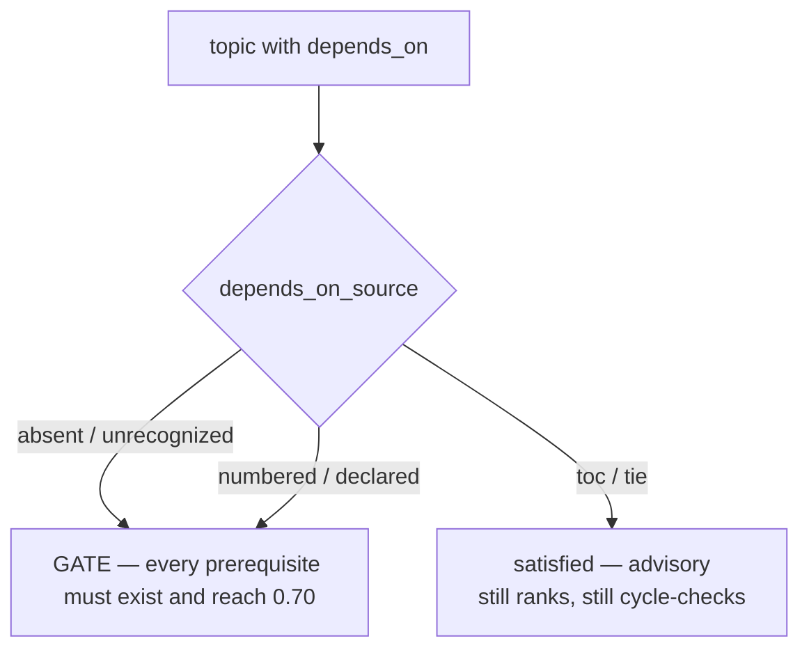

# ADR-0009: The Gating Model — What May Lock a Note

## Status

Accepted

## Context

`palee adopt --auto-chain` used to chain every note in scan order, and filesystem order was treated as prerequisite order. A 10-repository burn-in of 9,713 real markdown notes (#205: the prose figure is 9,713 notes; the same issue's strategy matrix separately lists 9,703 *edges* produced by the current default — a different quantity, not a competing note count) showed that default produced **98.2% semantically false edges in aggregate** — and a false `depends_on` is not cosmetic. Prerequisite gating (`>= 0.70` mastery) holds a note off `palee plan` until every prerequisite is mastered, and nothing raises `topic_mastery` automatically: `palee assess` (#228) is the only lever, and it needs the learner to enter scores by hand. A learner gated behind a nonsense note is effectively locked out, with `palee validate` counting a missing dependency only as a warning and exiting 0.

The engine itself was never the problem. Cycle detection, idempotency, and the never-rewrite-an-adopted-note rule all held. What was wrong was the inference policy: the tool was inventing prerequisites and then enforcing them.

The fix landed across #214–#241, and #204's "Known limitation" section records the scope decision that started it: ship the measured default, track the tiered fix, keep the invariants. This ADR records the rule that fix converged on, because it is the single highest-weight decision in the engine and it lived only in PR bodies and review threads.

## Decision

One rule, stated the way #223 stated it: **nothing that is not a prerequisite claim may gate a note.** An edge gates only when one of three things is true — the learner wrote it, the numbered tree justifies it, or the note itself declares it. Everything else ranks and cycle-checks, but never locks.

Provenance is stamped per note as `depends_on_source` in frontmatter, and the label decides gating:

| source | written by | gates? |
|---|---|---|
| *(absent)* | the learner's own frontmatter, or any build predating the label | **yes** |
| `numbered` | the numeric prefix in the note's path | **yes** |
| `declared` | the note's own text (`## Prerequisites` links) or its own frontmatter `depends_on` | **yes** |
| `toc` | a listing document's enumeration order | no |
| `tie` | filename collation between two same-rank notes | no |

The advisory set is two values, not three: `toc` and `tie`. Both still take part in cycle detection and in ranking the ready list — `detectCycles` and `palee validate` are untouched — so a TOC chain that closes a loop against authored dependencies still fails with exit 3.



**Fail-closed by construction.** `isAdvisoryDependsOnSource` returns true only for an explicit advisory label; `normalizeDependsOnSource` maps every unrecognized string to `undefined`, which gates:

```typescript
// src/types.ts
const ADVISORY_DEPENDS_ON_SOURCES: readonly DependsOnSource[] = ['toc', 'tie'];

export function isAdvisoryDependsOnSource(source: DependsOnSource | undefined): boolean {
  return source !== undefined && ADVISORY_DEPENDS_ON_SOURCES.includes(source);
}
```

A typo or a label an older build invented can only ever keep a gate in place, never relax one. The failure direction matters: demoting a hand-written prerequisite to advisory is silent and permanent (nothing raises mastery on its own), so it must be unreachable.

**Two rulings that sit on top of the table:**

1. **A `roadmap --auto-chain` synthesized edge is authored, not inferred** (#236). The learner typed that list into a file whose only job is to declare a prerequisite plan, and INV-47 already lets an explicit `depends_on` override the synthesis. So a synthesized roadmap edge is written with no label, and an absent label gates. Demoting it to advisory would be a behaviour change, not a labelling fix — the test in `cli-roadmap-wikilink.test.ts` pins exactly that, because the natural "consistency" refactor would have routed synthesized edges through the advisory labels and passed the entire existing suite.

2. **Label removal is keyed to authorship, not to a list comparison** (#223). `palee roadmap` drops `depends_on_source` whenever the entry declares `depends_on` — declaring the *same* ids still clears a stale label. The list-comparison version got both directions wrong: an identical declaration kept a stale `toc` label (the learner's gate silently advisory), and a title-only import — whose preserved list comes back unioned with the legacy `dependencies` key — looked like a change and turned advisory edges back into gates, re-locking the note.

## Consequences

### Positive

- A learner can no longer be locked out by an edge the tool inferred. The two advisory sources are the two shapes measurement showed were guesses.
- The gate question has one owner: `isAdvisoryDependsOnSource` in `src/types.ts`, read by `areDependenciesSatisfied` in `src/engine/dependency.ts`. Adding a source means adding a row to the table above, not hunting for read sites.
- Cycle detection and ranking are unchanged by the split, so the safety properties of the graph engine never depended on this decision.

### Negative / Tradeoffs

- **The policy is per note, not per edge.** `depends_on` is `string[]` and one label covers the whole list, so a note holding one authored prerequisite and one TOC-inferred predecessor gets one policy for both. #224 specifies the per-edge successor (`block | warn | hide`); until it lands, hand-editing `depends_on` on a note labelled `toc` leaves the learner's own new prerequisite silently advisory, and the documented remedy is deleting the label line.
- **A stored tie edge is indistinguishable from a numbering decision on the note alone.** A tie is a property of the *pair*, so a vault adopted before #234 keeps a `depends_on_source: numbered` label on an edge the alphabet decided, and `adopt` may not rewrite an adopted note. The backward half is `migrate --relabel-ties` (ADR-0023); the forward half (#234) simply stops producing the label.

## Alternatives Considered

1. **Keep inference gating and fix the inference instead.**
   - *Why Rejected*: #205's census is the argument. The failures were not a bug in the planner — every one was a real ordering signal that was not a prerequisite claim (translation copies, README enumerations, filename collation). No amount of classifier work turns "the author listed these in this order" into "this one requires that one." Structural heuristics reduced the clearly-false class to ~0%; the residual gap needs content reading, which is #206's Phase-2 design.
2. **A single binary "trusted" flag per note instead of a four-value label.**
   - *Why Rejected*: collapses the distinction the audit actually needs. `numbered` and `declared` gate for different reasons and migrate differently — #239's relabel pass has to be able to find exactly the stored `numbered` edges that were really ties. A binary flag would have made that pass unexpressible.
3. **Trust absent labels as advisory** (the opposite fail direction).
   - *Why Rejected*: an absent label is what every vault adopted before the label existed carries, and what a learner's hand-authored frontmatter looks like. Treating it as advisory would demote every hand-written prerequisite in every pre-#223 vault on upgrade — silent, permanent, and exactly the failure this ADR exists to prevent.
4. **Enforce gating at the edge level immediately** (per-edge policy in the first cut).
   - *Why Rejected*: the writer stamps one label per note, and the composition rules (#215) decide per note. Per-edge policy needs edge identity in the data model (#224's `via:` + `policy:` shape) to be more than a second all-or-nothing switch. Recorded as ADR-0013 instead.
