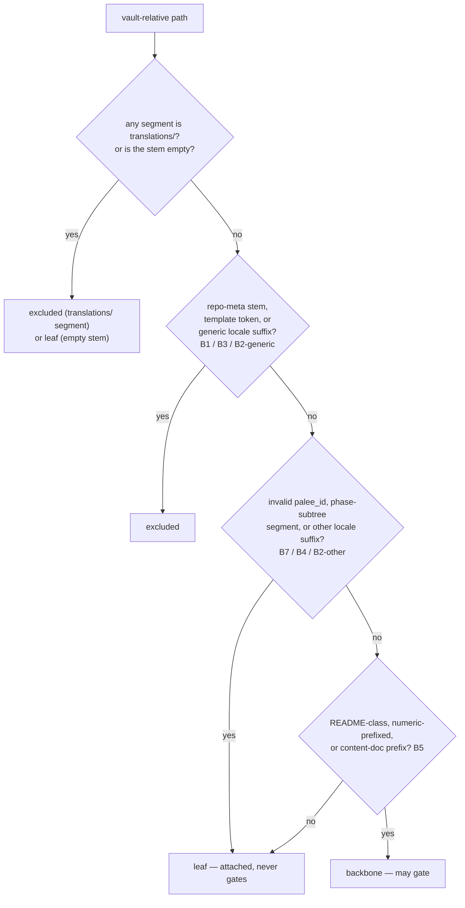

# ADR-0010: Tier-0 Hygiene Classification for Batch Adoption

## Status

Accepted

## Context

`--auto-chain` originally saw every markdown file in the scanned scope as a potential lesson. #205's census showed what that costs: `microsoft/AI-For-Beginners` chains through `translations/` (98.7% false), `trekhleb/javascript-algorithms` gates the English `README.md` behind its own `README.ko-KR.md` (65.1% false), and repo-meta files like `CONTRIBUTING.md` become first-class topics that gate real lessons. A translation copy and the note it translates are the same lesson; only one of them may decide the order of anything.

The fix is a classification pass that runs *before* planning on every batch adoption (#298), not only under `--auto-chain` (never opt-in - an explicit `--include` narrows the candidate set but cannot re-admit a note hygiene excludes; a learner who really wants one of those adopts it directly in single-file mode, which has no batch hygiene pass).

## Decision

`classifyNoteForChain(relPath)` in `src/engine/tier0-hygiene.ts` answers exactly one question per vault-relative path: is this note a **backbone** (may gate the chain), a **leaf** (attached to the chain, never gates), or **excluded** (never adopted, never chained)? Every batch adoption consumes the `excluded` verdict before staging notes; under `--auto-chain`, the planner (`planAutoChainWithHygiene`) also consumes `backbone`/`leaf` for ordering. The CLI reports the verdict per rule (B6).

The classification rules, as shipped:

- **B1 repo-meta** (`REPO_META_STEMS`): `license`, `contributing`, `changelog`, `code_of_conduct`, `security`, `support`, `faq`, `help`, `funding`, `agents`, `cname`, `index`, `home`, `toc`, `contents` and siblings — data, not law; the list is a blocklist, not an ontology.
- **B2 translations**: a locale-suffixed *generic* doc name (`README.ko-KR.md`, `CHANGELOG.fr.md`) is unambiguously a translation copy and is **excluded**; a locale suffix on any other unnumbered name (`assignment.es.md`) is a name-based guess that only **demotes to leaf**. A numeric prefix exempts the name from both arms — `02-es.md` is the Elasticsearch lesson, not a Spanish translation of lesson 2 — and the structural `translations/` segment stays the authoritative signal for translated lessons. Locale detection is deliberately narrow: tokens that collide with programming languages (`js`, `ts`, `la`) never count, so `guide-js.md` is not read as a translation.
- **B3 templates**: `template`/`templates` as a whole token in a stem or directory segment, never as a substring — `03-cpp/02-templates.md` is a C++ templates module, not a template, and a numeric prefix exempts it exactly as the locale arm does.
- **B4 phase subtrees**: any non-final path segment naming a phase directory (`solutions/`, `your-work/`, `start/`, `sketch/`, `answers/`) collapses its whole subtree to leaves — the work exists, the enumeration does not.
- **B5 content-doc names**: README-class (`readme`, `summary`), numeric-prefixed, or phase-prefixed basenames (`lab-`, `deep-dive-`, `exam`, `assignment-`, `quiz`, `solution-`, word boundary required — `labnotes` does not qualify) are backbone-eligible.
- **B7 invalid `palee_id`**: a truthy non-string `palee_id` (YAML reads `palee_id: 12345` as a number) is demoted to a leaf — `classifyNoteForChain` returns reason `invalid-palee-id`, so the note stays attached to the chain but never gates the notes after it — because under `--auto-chain` such a note used to be treated as an adopted bridge note and then resolve to no id at all, making it an unsatisfiable predecessor that silently blocked everything chaining after it.

Three sub-rulings the review round produced, each with its own test:

1. **Region aliases are locales** (#214). `localeSuffixKind` consulted `LOCALE_REGION_ALIASES` only when a trailing region also matched, which cannot happen on its own — every alias that reaches that line is already accepted by the ISO-639 arm. So `assignment.cn.md` stayed backbone (able to gate the next note) while the identical `assignment.es.md` demoted to leaf: one document, two readings, and only the Chinese one could lock a learner out. Aliases are now treated as locales, matching `.es` exactly.
2. **`FAQ.md` / `HELP.md` are excluded, not leaves** (#214). Both appear in #205's own measured false edges (`HELP.md depends on FAQ.md`) but sat only in `GENERIC_DOC_STEMS` — the loose locale arm. A `leaf` is still adopted and still a legal TOC predecessor, so neither name was actually prevented from gating a lesson. They now join `REPO_META_STEMS`.
3. **The vault-root README bridges into the first numbered module** (owner ruling, PAL-205-G2). A root `README.md` enumerating `MODULES/01-foundations/…` chains onto the first numbered module at *any* depth — the first-segment-only rule was unreachable in the `MODULES/01-foundations/` layout the project itself uses.

And one that #411 fixed after the fact (the defect was filed as #330): **an empty stem is a leaf, never a backbone.** `stemOf` returns `''` for any non-`.md` basename, and the classifier promoted that to the class whose job is to gate other notes — the opposite of the module's own stated failure direction ("the failure direction is always 'demote to leaf', never 'chain as a lesson'"). A file that can never be a lesson was allowed to decide the order of lessons around it.

## Consequences

### Positive

- The chain stops inventing prerequisites out of repo furniture. The three dominant causes in #205's census — translation copies, meta files, and phase subtrees — are all classified out before planning runs.
- Every excluded note is accounted for. Every batch prints the per-rule skip counts on the dry-run and the commit screen alike, and prints even when nothing survived filtering: silently discarding the learner's notes is the failure mode the pass exists to remove. Under `--auto-chain` the same report adds backbone/leaf counts.
- One predicate, one planner. `classifyNoteForChain` is pure and exported; the CLI's report and the planner's input cannot disagree because they call the same function.

### Negative / Tradeoffs

- **Scope is no longer coupled to `--auto-chain`** (#298, fixed). Every batch now drops `excluded` notes before staging, so a plain `adopt --all` no longer adopts machine translations or repo-meta notes that `--auto-chain` would skip. README/SUMMARY remain the one intentional difference: a plain scan skips them as navigation docs (#442), while `--auto-chain` keeps them as chain backbone. Single-file adoption remains the override (ADR-0022).
- **The classifier is a heuristic about names, and the locale-collision arm is a no-op today.** `LOCALE_CODE_COLLISIONS` (`js`, `ts`, `la`) only stops a note being *read as a translation*: `guide-js.md` is an unnumbered non-content sibling either way, so it classifies as a `leaf`, not a backbone lesson. The arm changes nothing until one of those codes is actually added to the language list — and the docstring says that plainly instead of implying a guard that fires.

## Alternatives Considered

1. **Run hygiene only on request** (an opt-in flag).
   - *Why Rejected*: the false edges are the default's output. An opt-in pass leaves the measured 98.2% failure as the default behaviour for anyone who does not know to ask.
2. **Filter inside the planner instead of a separate classification pass.**
   - *Why Rejected*: the CLI has to report *why* each note was skipped, per rule, on the same screen that previews the writes. A pass that only removes notes cannot produce that report without re-deriving the same predicates a second time — the exact duplication that lets the two disagree.
3. **Trust an extension allowlist** (`.md` only, which `walkVault` already applies).
   - *Why Rejected*: every measured false edge in #205 was a `.md` file. The failures were all in *names*, not extensions.
