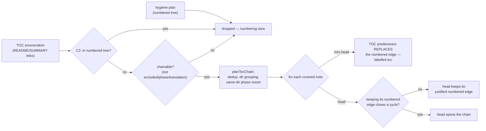

# ADR-0011: Tiered Auto-Chain — strict | toc | full

## Status

Accepted

## Context

ADR-0009 established that only three things may gate: the learner's own list, the numbered tree, and the note's own declaration (ADR-0012). This ADR records how the numbered tree and the repo's *own enumeration* are combined into a chain, and why the default tier is the one that produces the fewest edges.

The numbered tree was never the problem child. #205's census found the false edges in enumeration order and filename collation, and the tiered fix exists because a vault whose names carry no real prerequisite signal should produce *no edges* rather than alphabetical ones. #204 shipped the measured default with the fix tracked; #214–#248 landed it.

The TOC tier (PAL-205-C) adds a second order source for exactly the vaults the numbered tree does not cover: the repo's own `README.md` / `SUMMARY.md` enumeration, in document order. A maintainer who lists `guide/intro` before `guide/core` has stated an order; that is a weaker claim than a number, and a much stronger one than the alphabet.

## Decision

### The flag surface

`--auto-chain` is a plain boolean; the tier is a separate option.

```
palee adopt <dir> --auto-chain --chain-tier <strict|toc|full>   # bare --auto-chain = strict
```

An optional-value flag (`--auto-chain=toc`) was tried and rejected: Commander hands it the next positional, so `palee adopt --auto-chain MODULES` reads `MODULES` as the tier and exits 2 having adopted nothing. `enablePositionalOptions()` does not fix that and makes a directory literally named `toc` ambiguous (#215). A tier that is not stated — including a bare `true` reaching the parser — is a usage error, never a silent default back to the widest tier (#247).

### Tier semantics

| tier | consumes | edges labelled |
|---|---|---|
| `strict` (default) | the numbered tree only | `numbered`, plus `tie` for same-rank filename collation |
| `toc` | the numbered tree + author enumeration | as above, plus `toc` where the enumeration speaks |
| `full` | identical to `toc` today — the separation is reserved for a future third source | same |

### Composition rules



- **C2 numbering dominance is structural, not a tie-break.** `isInNumberedTree` filters numbered-tree paths out of the TOC candidate set before planning runs, so where both tiers could speak, numbering always wins. (Measured raw-TOC regressions: 4/271, all of this shape.)
- **TOC edges replace, never join.** For every covered non-head the enumeration's predecessor replaces the numbered plan's predecessor — *including* a structure-justified same-directory edge, not only an alphabetical fallback. Replacement is where the measured false edges die.
- **A chain head never silently loses a justified edge** (C-defect-1, the rework `0d10120`). Since the Tier-0 rework every non-null numbered predecessor is structurally justified, so a head keeps its existing edge and its `numbered` label — unless walking predecessors from the kept note reaches the head, in which case the head opens the chain instead.
- **The tier advice is gated on `tocCandidateCount > 1`.** Counted as notes, not links — a README that reaches the same lesson twice offers the toc tier one note, and counting links advised a tier that would then write nothing. A lone candidate is a chain head, so the toc tier writes no edge there either, and the advice produced a second identical refusal with the roadmap pointer suppressed.
- **Honest refusal.** The `strict` tier reports zero edges — with the `--chain-tier toc` suggestion only when the enumeration holds something a toc tier could actually order, and the `palee roadmap` pointer otherwise — rather than falling back to alphabetical prerequisites. The refusal is a conjunction: no numbered layout, no resolved TOC link, zero planned edges, no declared dependencies, no hand-authored `depends_on`.
- **The alphabetical warnings are recomposed after composition.** A note the enumeration placed is no longer reported as "chains in alphabetical order" — the CLI used to say that two lines above a plan reporting every one of that note's edges authored by `toc`, and suggest `--exclude` for notes the tier had just sequenced correctly.

### Ordering inside the TOC chain

`planTocChain` produces one linear chain: first-appearance dedup, directory groups in first-appearance order, and inside a group the same-directory resort — README-class first, numeric by number, then `deep-dive → lab → exam` in that pedagogical order, then any other doc, and **`assignment`/`quiz`/`solution` last so homework never gates the docs that follow it**. Ties at every rank keep the author's document order; alphabetical would be the arbitrary chaining this tier exists to remove.

Cycle-freedom is a constructed property — a strictly linear walk over a deduplicated list — and it is asserted in code (`assertBackwardEdges` for the TOC plan, `assertAcyclicPlan` for the merged graph) rather than trusted to tests alone.

### Link-parsing discipline

A destination means what the author wrote. The scanner follows CommonMark 0.31.2 §2.4 (backslash + ASCII punctuation is an escape; digits and letters are not), splits the fragment at the first *literal* `#` before percent-decoding (so `%23` survives as a `#` in the path), keeps the escape marks on exactly `#`, `%` and `\` until after the split and decode, refuses a bare destination carrying an unescaped space rather than truncating it onto a shorter real note, and never re-trims a decoded destination (`notes/file.md%20` is a note whose name ends in a space, not `notes/file.md`). Fenced code, HTML comments and inline code spans are blanked before scanning, through one shared `stripUnfollowableMarkup` that the declared-prerequisite scanner calls too — a link written to be read is not a link written to be followed. Quadratic rescans on stray brackets are bounded by precomputed bracket-balance tables (#263, #287).

## Consequences

### Positive

- A vault with no order signal produces zero edges and an honest refusal, instead of alphabetical prerequisites that gate.
- Where both tiers speak, numbering wins by construction — no precedence table to get wrong.
- The learner is told which tier authored each edge (`depends_on_source`), so a `toc` edge is visibly advisory and a `numbered` edge is visibly a decision.
- The scan is linear in document size; the balance tables turn the pathological README (a pasted diff, a generated index) from an 82-second stall into a 4-millisecond one (#275's table, both sides measured in the same run).

### Negative / Tradeoffs

- **Two flags for one concept.** `--auto-chain` and `--chain-tier` are separate because the merged form was broken, not because two flags are clearer. The help text has to say the default is `strict` in both places.
- **`full` is currently identical to `toc`.** The name reserves a slot for a future third source; today it is an alias, and the docs say so rather than implying a difference.
- **An ordinary leaf can still be placed by a README under `toc`/`full`.** `tocChainable` declines only excluded, phase-subtree and translation classifications — restricting candidates to backbone would leave the tier nothing to chain, since the notes it speaks for are precisely the unnumbered ones. What stops such an edge gating is `toc` being advisory (ADR-0009), not the hygiene classifier.

## Alternatives Considered

1. **Make `--auto-chain` carry an optional tier value.**
   - *Why Rejected*: Commander hands an optional-value flag the next positional. `palee adopt --auto-chain MODULES` read the directory as a tier and exited 2 having adopted nothing — a regression of a form the command had always accepted. `enablePositionalOptions()` leaves that broken and makes a directory named `toc`/`strict`/`full` ambiguous.
2. **Default to `full` (both tiers always on).**
   - *Why Rejected*: the 76.4%-false census is over enumeration-tier edges. Listing order is a weak signal; making it the default would ship the measured failure as the default behaviour. The default changes because enumeration is a guess, not because numbering is proven.
3. **Let TOC edges join numbered edges instead of replacing them.**
   - *Why Rejected*: one `depends_on_source` label covers a note's whole list, so keeping an inferred `toc` edge beside a declared or numbered one would quietly promote a guess into a gate — the exact defect ADR-0009 exists to contain. A note that states its prerequisites has no need of a guess about them.
4. **Let a TOC chain head overwrite its numbered edge like every other note.**
   - *Why Rejected*: C-defect-1. Since the Tier-0 rework every non-null numbered predecessor is structurally justified; nulling a head's edge deleted a real order statement because the enumeration merely did not mention the note. Heads now keep their edge unless keeping it closes a cycle.
5. **Trust the tests for cycle-freedom instead of asserting it in code.**
   - *Why Rejected*: the property the tier promises is stronger than the old alphabetical chain had for free, and composition can legitimately interleave tiers so list position no longer proves acyclicity. The asserts cost nothing and fail loudly if the construction ever changes underneath.
